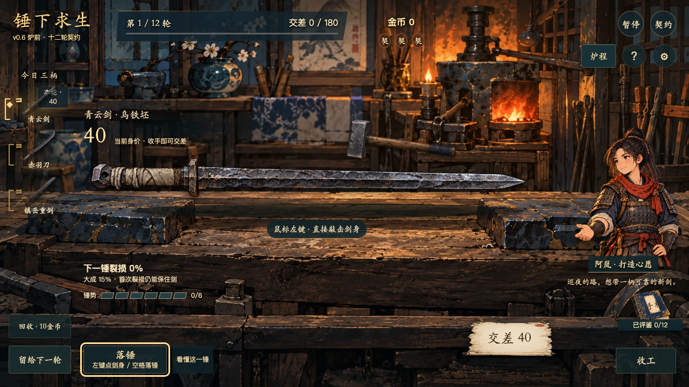

# sword-led · 锤下求生

一款面向现代 PC 浏览器的轮次制锻造游戏。每轮只有三件铁坯：点击落锤让它升值，在断裂前决定交货、留剑还是回收，靠手艺和商人升级撑过契约。

**当前首页为 v0.6「炉前」：[打开本机预览](http://127.0.0.1:4179/)**。按用户指定的Game Studio UI/Playtest指导重排：中央剑与铁砧为操作主体，点击炉边来客看心愿，交剑靠近来客、留剑靠近剑架；保存/设置按需展开。重要事件签能读完、收起和进入下一步，“炉程”回看当前目标、真实成长与经历。原手札仍记录实际成品。[界面说明](docs/v0.6-workshop-interface.md)说明具体交互；[R3.18复核](docs/reviews/R3-18-game-studio-forge-ui.md)记录实际构建、失败与复验边界。

刷新原标签页，左上为“v0.6 炉前”。原进度直接续玩；已有三轮档按原长度继续，要玩十二轮可在“契约”选择并明确新建，确认前可导出旧进度。新空档默认十二轮，[三轮练手](http://127.0.0.1:4179/?mode=3)保留。仍然左键直接落锤，不合来客建议也能交差；原规则、锤姿、成长、静音和减弱动效保持。



[完整实况复核](docs/research/2026-10-19-forgetax-session-study.md)、[批准方案](docs/v0.4-gameplay-proposal.md)、[十二轮规则](docs/v0.4-campaign.md)与[来客美术原件/提示词](design/d/v05/README.md)保留研究与实施身份。[26,000局模型审计](docs/reviews/R4-v3-model-audit.md)发现固定七次点击也能通关；[后续1152局补证](docs/reviews/R3-16-purpose-and-directed-review.md)证实主动保险和带裂手艺有实际用途，但不证明整体乐趣。用户最新仍认为缺少主线/成长/内容；[v0.7完整游戏提案](docs/v0.7-complete-game-proposal.md)已获明确确认，**全部十二天玩法内核及独立存档/炉谱已接通，生产界面继续分阶段开发**。详见[内核合同](docs/v0.7-core-contract.md)、[保存合同](docs/v0.7-persistence-contract.md)与[R3.19复核](docs/reviews/R3-19-lantern-core.md)。当前v0.6网页继续forge-v3/schema3，旧模式/档和历史证据保留；整体H、最终广矩阵与最大审查未完成。本机预览未公网部署。

2026-10-18真人曾评价v0.2玩法/美术缺乏新意；已据ForgeTax及110条唯一Steam评论修订并取得明确v0.3批准。[核心证据](docs/reviews/R3-5-v2-core-and-playable.md)保留928局策略与原试玩结果，[D界面说明](docs/v0.3-d-interface.md)记录新接线与独立练习。[新版技术验收](docs/reviews/R3-7-v2-technical-acceptance.md)与[44AC映射](docs/v0.3-acceptance.md)分别记录实际矩阵、故障修复及待办。真人再玩和最大交付仍按T11.4.2–T12推进，技术通过不等于玩家满意。

## 项目资料

- [Steam玩法/评论研究](docs/research/2026-10-18-forging-games.md)：抽样方法、正负体验、具体评论回链和现版设计诊断。
- [行旅版场景与反馈](docs/v0.4-workshop-scene.md)：实物工坊、上下文引导、交接/达标/归架等真实反馈，以及商人/收据/终局作品。
- [v0.4完整契约](docs/v0.4-campaign.md)与[基础玩法](docs/v0.4-playable.md)：即时增值、裂损/连锻、保险剑、三次商人、胜负与账本；旧三轮档继续练手。
- [已确认v0.3改版提案](docs/v0.3-gameplay-proposal.md)与[D方向图](design/v03/README.md)：锻脉/试剑/技法构筑、样例/风险/新旧档与实施验收。
- [v0.3核心与试玩](docs/v0.3-core-and-preview.md)：操作、共享存储适配口、独立存档/SDK、928局策略边界与复跑命令；[R3.5](docs/reviews/R3-5-v2-core-and-playable.md)保留三任务复核与后续责任。
- [forge-v2原规模模型审计](docs/reviews/R4-v2-model-audit.md)：29组合各1000种子、旧928重叠与正式胜负回放、压缩原结果和16项审计拒绝检查；只验证旧规则技术条件，不替代真人乐趣或新v0.4验收。
- [游戏设计文档](docs/game-design.md)：完整玩法、材料来源、锻造风险、回收/交货、商人、配额、惩罚与胜负。
- [实施方案](docs/implementation-plan.md)：确认范围、开发阶段、工具命令合同与交付门槛。
- [代码架构](docs/architecture.md)：纯内核、状态机、随机数、输入时序、可靠存档与模块分工。
- [商人与存档合同](docs/persistence-and-merchant.md)：交易、回放、保存/冲突/备份与浏览器接线。
- [三套主界面候选](design/README.md)：A 余烬工坊、B 行会手账、C 冷铁控制台，最终选型图、比较和完整提示词。
- [界面与风格](docs/ui-design.md)：完整页面、信息结构与三图共同状态。
- [验收矩阵](docs/acceptance-matrix.md)：44项场景；已有规则、存储、模拟与工坊输入证据，整局UI/真人验收继续按任务完成。
- [R4审查检查点](docs/reviews/R4-final-audit.md)：原始五项/44AC/V3逐项结果、恢复提示修补、历史v2策略规模批次与未完成的真人门槛；[REPEAT](docs/reviews/REPEAT-2026-10-19.md)记录只扩展有据的重复流程。
- [首次全面复核 R1](docs/reviews/R1-design-and-concepts.md)：规则闭环、架构、图稿检查、修正与后续验证责任。
- [确认记录](docs/decision-record.md)：用户已确认实施并选择 B，原始问答留存。
- [T04 内核验证](docs/reviews/T04-kernel-validation.md)：77 项测试、类型检查、构建与独立产物验证，含本轮边界。
- [T05 交易与存档验证](docs/reviews/T05-persistence-validation.md)：141 项测试、8 项浏览器集成测试与真 BFCache 证据。
- [模拟合同](docs/simulation-contract.md)与 [R2 内核/平衡报告](docs/reviews/R2-kernel-and-balance.md)：53,000行证据、正式通关/失败回放、锤法/升级/辅助/滥用对照与150项测试。
- [B派生美术包](design/b/README.md)与[T07验证](docs/reviews/T07-art-validation.md)：9张运行图、24材料帧、完整状态/流程设计、色板和可复跑拼装预览。
- [工坊接线合同](docs/workshop-implementation.md)与[T08验证](docs/reviews/T08-workshop-validation.md)：175单测、26页面检查、8存储回归、原生Chrome最小化/恢复与实际截图。
- [经营/终局接线](docs/contract-flow.md)与[R3报告](docs/reviews/R3-full-contract-flow.md)：真实页面成功/失败、商人、账本、重开与T07–T09联合复核。
- [设置/音效/恢复合同](docs/settings-and-audio.md)与[T10品质报告](docs/reviews/T10-quality-validation.md)：独立设置、短音效生命周期、纯键盘整局、异常恢复与实际回调预算。
- [OpenSpec 提案](openspec/changes/add-forging-game/proposal.md)：四项新能力，已批准、分阶段实施。
- [原始输入](goal-1/input.md)：用户需求逐字保存。
- [执行计划](goal-1/plan.md)：实施顺序、验证、风险和回滚。
- [任务与执行记录](goal-1/tasks.md)：逐项进度、审查和提交证据。

## 开发顺序

先完善并复核游戏设计和实施文档，使用 imagegen 提供三套主界面候选。用户确认实施方案后先开发独立玩法内核；主界面选定后派生美术并完成网页全流程。测试、模拟、浏览器试玩与最终审查均保留实际证据。

v0.2三套候选、内核/R2/B美术与完整UI保留。v0.3已实施独立[core-v2](src/core-v2/index.ts)及真实试玩，仍用`createRun/applyCommand/getRunView/validateRun`，并提供只读试剑/作品簿。共享会话保护分别注入v1/v2解释器，界面不自行加钱或抽随机。D资产/全界面已连接，最终验证与真人反馈继续推进，旧模拟不能证明新玩法。

## 本地游玩与验证

使用 `.nvmrc` 的 Node 22.12.0，或 `package.json` engines 允许的版本。npm 精确锁定 TypeScript、Vite、Vitest 和 Node 类型，当前没有第三方运行时依赖。

```bash
npm ci --registry=https://registry.npmjs.org/
npm run dev
```

打开终端显示的地址，默认`/`为v0.6炉前（forge-v3规则），`/v2.html`为旧D细锻，`/legacy.html`为B版旧契约。生产版本用`npm run build`后`npm run preview`，默认端口4173。构建包含三个HTML、网页资源与core/session/v2/v3/v4 SDK及共享chunk，应整体保留dist，不提交dist或node_modules。v4已导出独立局档/炉谱会话，具体API见[保存合同](docs/v0.7-persistence-contract.md)；新主线网页接线继续开发。需要通过localhost或HTTPS运行。

| 操作 | 用法 |
| --- | --- |
| 落锤 | 中央剑身区域鼠标左键；键盘聚焦落锤后松开空格，或Enter激活；无需卡时机 |
| 换剑 | 左侧剑架点击，或Tab/Shift+Tab移动后Enter选择 |
| 暂停 | Esc或暂停按钮；后台/失焦取消准备，不偷扣资源 |
| 交差/回收 | 交差计本轮目标和金币，回收只给底价的四分之一金币；处置后不可再加工 |
| 操作设置 | 静音/音量、减弱动效自动独立保存；系统动效优先，失败可重试；旧细锻模式另有慢速时机 |
| 声音 | 首次手势后启用；游戏顶部可静音，设置中可试听；暂停/后台/菜单会停止 |

每个接受动作后尝试保存，失败保留内存进度并提示重试；菜单继续会保留未保存工作副本。旧两版的独立教学与显式不保存试玩不写正式档。同源另一窗口只读，关闭占用窗口后可重新读取。

保存故障可确认保留当前局继续不保存；刷新/关闭会失去这份试玩，本机磁盘契约保留。坏档不自动删除，合法备份恢复前显示轮次与时间；备份写失败会明确区别于主档写失败。设置故障不阻断正式锻造。旧两版教学初次使用慢速，可在设置中调整；v0.4直接落锤，不使用时机速度。

临时[可玩预览](http://127.0.0.1:4179/)使用已验证构建快照，具体版本和实际存活检查见[执行计划](goal-1/plan.md)。仅当前机器/服务存活时可用；其他机器按上述命令运行，没有宣称已互联网部署。

工程检查按顺序执行，避免同时构建共用的dist：

```bash
npx playwright install chromium
npm run check
npm run test:browser
npm run test:art
```

当前forge-v3界面回归需在构建后单独运行 `npx playwright test --config playwright.v3.config.ts`（Chromium/Firefox/WebKit须已安装）；不要在浏览器批次运行时重建共用dist。

`check`运行单测、严格类型检查与双构建。`test:browser`一次构建后串行运行正式页面与存储SDK；也可分别用`test:e2e`/`test:storage:browser`。真实Chrome原生窗口/缓存探测采用隔离profile；测试只改变测试侧时钟/事件，不注入钱包/终局。美术检查使用独立设计页，不作为正式游戏验收。单项命令还包括`npm test`、`npm run typecheck`、`npm run build`和交互`test:watch`。

当前forge-v3规则与v0.5界面的配置可在同一构建上测试三种引擎：

```bash
npm run build
npx playwright test --config playwright.v3.config.ts
```

使用4186端口、单worker、无重试；当前枚举105项（三引擎各35），含21项来客/册页/无门槛交差/错误回退，以及此前84项锻造、成长、完整十二轮/失败/商人/保存和场景回归。完整局用原生Tab/Enter/Space逐命令对照正式内核。本次实测为主改版102项全过，最后册页专属CSS修补后21项全过；45个产物路径不变，主JS改名但内容同字节，不把这两份报告称为一次105全绿。报告见[R3.17](docs/reviews/R3-17-traveler-notebook.md)；最终全DPR/原生生命周期/组合故障/音频/性能矩阵另验。

跨引擎工具：`npx playwright install firefox webkit`后可执行旧版/混合定向配置`npm run test:cross`。旧D细锻矩阵单独执行：

```bash
npm run build
npx playwright test --config playwright.v2.config.ts
```

新版配置使用4182端口、单worker、无重试。R3.7首版基线为六个Chromium/Firefox/WebKit的DPR1/2项目各35项加原生Chrome两项，共212项；本次主界面二版新增视觉流程用例，实际枚举和结果以当前报告为准，不能把旧212称为新构建全量通过。每个项目都包含纯键盘十二轮、三商人、失败重开和组合保存故障；两种桌面尺寸由规格明确覆盖。输出`test-results/v2-release/`与`test-results/v2-release-report.json`，不会覆盖旧版/存储报告。原生Chrome窗口/缓存探测独立标记，不会伪标为Firefox/WebKit。运行中不要重建同一个dist；具体结果以技术验收报告为准。Playwright WebKit引擎不是在真实Safari产品上验收，Chromium也不等同真实Edge。[贡献说明](CONTRIBUTING.md)列出证据归档与边界。

整局模拟与回放：

```bash
npm run simulate -- --seeds 1000 --workers 6 --out tmp/my-verification
npm run simulate -- --replay docs/evidence/T06/verify-v1.medium-victory.json
```

默认53场景，每个最终状态都完整回放；输出统计JSON、逐局CSV.gz与胜负witness。已有输出不会覆盖；参数、输入误差假设和指标边界见模拟合同。T06 实测批次约18分钟，速度取决于设备，模型输入秒数不等于脚本耗时或真人整局时长。

B旧版入口为`/legacy.html`，D细锻为`/v2.html`，v0.4为`/`；开发服务还提供`/design/b/preview/index.html`美术校验页。`test:art`核对B风格的9张图片、alpha、288姿态、24材料帧和设计组件；D素材在新版UI/alpha规格中核对，两者证据分别记录。旧阶段机器证据归档工具为`node scripts/collect-ui-evidence.mjs --stage T10 --out <新的证据目录>`，已有证据不覆盖；归档前需生成最新unit/UI/storage报告。新版完整矩阵使用贡献说明中的v2 collector。

构建后可在 Node 中调用同一个正式内核：

```js
import { createRun, applyCommand, getRunView } from './dist/sword-led-core.js';

const created = createRun({ runId: 'example-run', seed: 'forge-demo' });
if (!created.ok) throw new Error(created.error);
const hit = applyCommand(created.state, {
  runId: created.state.runId,
  expectedRevision: created.state.revision,
  action: { type: 'strike', pieceId: '1:1', mode: 'standard', timingMark: 5000 },
});
if (!hit.ok) throw new Error(hit.error);
console.log(getRunView(hit.state).selected);
```

动作拒绝不改变原状态、随机位置或修订号。只对内核创建或 validateRun 校验过的状态调用；浏览器使用持久化会话自动尝试保存每个 Accepted 动作，dirty/冲突/显式恢复见存档合同。

## 素材与发布

游戏名称暂定。AI 生成素材会连同提示词、版本与项目路径记录，最终运行素材在仓库内保存。仓库初始为私有；未另行指定开源许可，公开发布与商业使用的素材授权在交付前核查。
