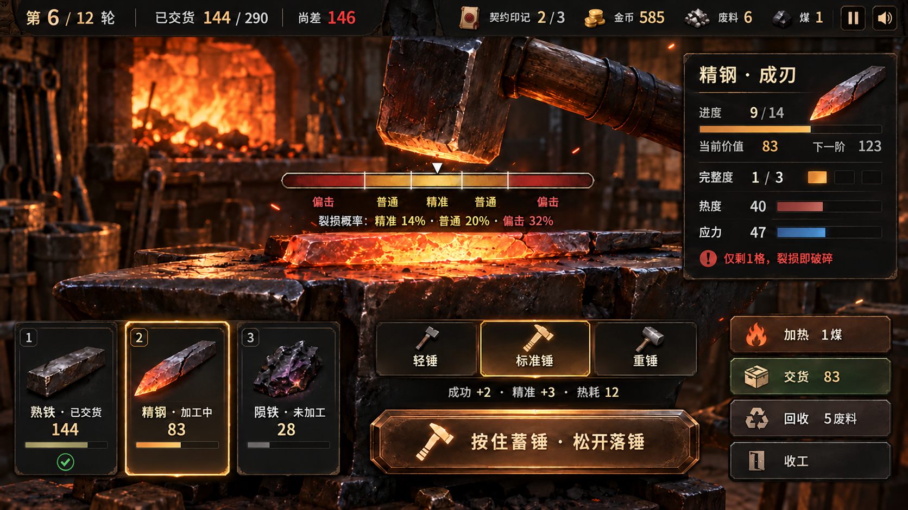
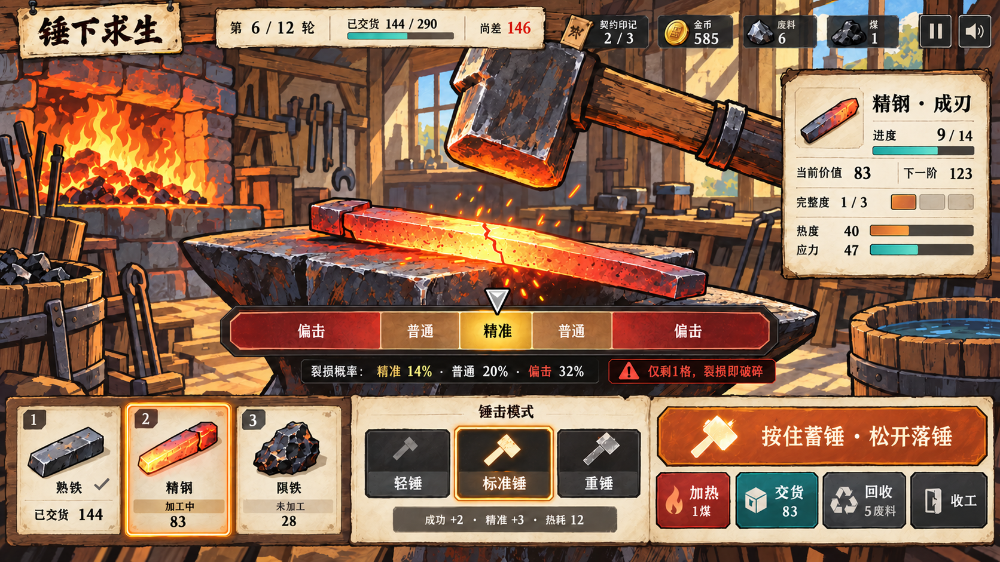
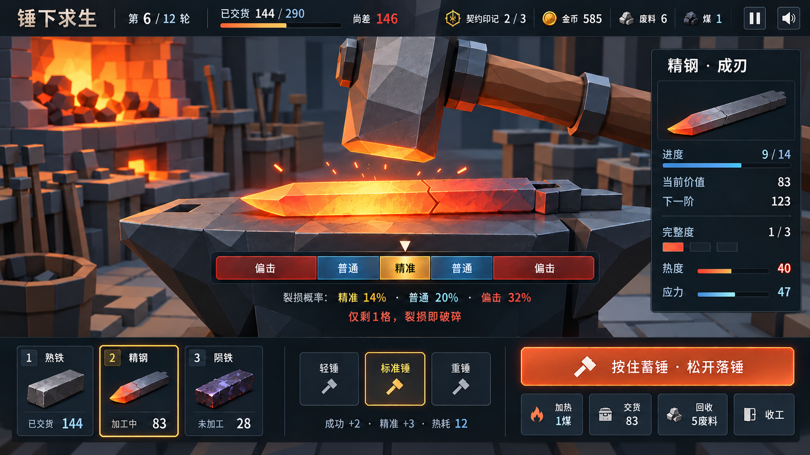

# 《锤下求生》主界面候选

**当前默认产品为v0.8“炉边交易 · 三柄行囊”，方向沿D「行脚灯炉」及用户后来指定的近景稿。** 本页保留最初A/B/C三候选与B初选，不是现行版仍待选图。后续的[D偏好原答与探索](v03/README.md)、[近景指定稿/正式D派生](d/README.md)、[三章终局原件与prompt](d/v07-chapter3/README.md)构成实际更新链；当前三章十二天、自然锤、直接左键/拖交与炉边交易见[操作指南](../docs/v0.8-twelve-lights-guide.md)和[R3.24](../docs/reviews/R3-24-v08-growth-trade.md)。原图、提示词与当时选择均保留，不重新询问风格。

时间线：先选B「行会手账」，后偏好D原稿；用户后来指出构图未落实并重新附图，项目副本为 `d/reference-main-v2.png`，用于正式近景修订。该副本与早期探索名 `v03/concepts/main-b2-v1.png` 同字节；“B2未选”只描述最早探索时点，不否认后来用户指定这张图。当前仍称D方向，不因历史文件名混淆授权或另造选型。

## 历史三候选与初次选择

T03 / 2026-10-17。以下 **v3** 是三个最终候选；用户随后明确选择 **B「行会手账」**，见[确认记录](../docs/decision-record.md)。T07已完成[B派生美术包](b/README.md)；本页保留概念与迭代证据，不是已可运行游戏。

共同状态：第 6/12 轮，已交货 144/290，尚差 146；金币 585、废料 6、煤 1、印记 2/3；精钢成刃价值 83、下阶 123、进度 9/14、完整度 1/3、热度 40、应力 47；精准/普通/偏击裂损风险 14%/20%/32%。跨轮账目与风险推导见 [UI 约定](../docs/ui-design.md)。

## A · 余烬工坊

深色炉火、写实金属和近距离锤砧，强调锻造触感与风险。三者中最贴近“再敲一锤可能报废”的紧张气氛。

优点：热铁是清楚的视觉中心，器具材质强，当前价值/临界破损醒目。后续要注意：背景火光与特效不要争夺数值可读性；素材须拆层；较小尺寸的风险文字需代码重排。工坊 HUD 未放游戏名，比选页与最终主菜单仍需完整标识。

## B · 行会手账

二维手绘工坊、墨线工具和纸面订单，较明亮、亲切，强调经营与规划。

优点：订单和材料卡阅读轻松，画面有手作感，工具轮廓清楚。后续要注意：背景线条与火焰需要克制，纸签不能堆成厚重菜单；裂损/破碎反馈仍要有分量，不能因温暖风格弱化风险。

## C · 冷铁控制台

几何低多边形器具、冷灰工坊和简洁读数面板，热铁保持唯一强暖色焦点。画面是 3D 视觉语言的二维图稿，不意味着要引入实时 3D 引擎。

优点：物件形态与数字层次清楚，控制区规整，锤砧与背景风格统一。后续要注意：不能演变成普通数据面板；材料阶级和裂纹变化需要保留辨识度；几何感不能替代敲击力度反馈。

## 比较与建议

| 比较点 | A 余烬工坊 | B 行会手账 | C 冷铁控制台 |
| --- | --- | --- | --- |
| 第一印象 | 紧张、炉火、金属触感 | 温暖、手绘、经营 | 冷静、几何、精准 |
| UI 材质 | 深铁/铜边 | 纸签/木板 | 细线/石板灰 |
| 场景表现 | 细致写实材质 | 明确二维线稿与绘画 | 明确切面低多边形 |
| 对玩法的强调 | 这一锤的重量与风险 | 今天如何分配三件材料 | 读风险并精准操作 |
| 衍生重点 | 分层、光照一致、暗部可读 | 线稿统一、状态形态和纸面布局 | 形状/锚点统一、反馈有力度 |

基于原始“控制铁锤敲铁件、成功增值、可能破坏”的方向，建议优先考虑 A；B 更适合希望亲切经营氛围的方向，C 更适合偏简洁、精准的方向。这是设计建议，不是用户选择。

图稿里计时区域宽度、进度填充和字号是近似表达；正式 UI 必须按规则视图精确绘制、提供可编辑文本/真实按钮，并在 1280×720 与 1920×1080 实测。这三张图片不作为整张游戏背景直接上屏使用。

## 生成模式、提示词与版本

使用 **内置 `image_gen.imagegen`**；未使用 CLI/API key 路径，工具未公开具体模型标识，不推测模型名。三套原始生成独立调用；所有修改也使用该工具。完整提示词与引用链如下：

| 候选 | 原始生成 | 样式/计时修正 | 最终账目修正 |
| --- | --- | --- | --- |
| A | [v1 prompt](prompts/main-a-v1.md) | [v2 edit](prompts/main-a-v2-edit.md)，以 A v1 为目标修正计时条 | [v3 edit](prompts/main-a-v3-wallet-edit.md)，以 A v2 为目标 |
| B | [v1 prompt](prompts/main-b-v1.md) | [v2 edit](prompts/main-b-v2-edit.md)，以 B v1 为目标改为二维手绘 | [v3 edit](prompts/main-b-v3-wallet-edit.md)，以 B v2 为目标 |
| C | [v1 prompt](prompts/main-c-v1.md) | [v2 edit](prompts/main-c-v2-edit.md)，以 C v1 为目标改为低多边形 | [v3 edit](prompts/main-c-v3-wallet-edit.md)，以 C v2 为目标 |

三套最终文件均为 1672×941 PNG，约 16:9。没有为凑整尺寸裁切或改写生成像素。v1/v2 是迭代证据，不作为本次选图版本；它们含旧 240 金币或已记录的初稿问题。

完整 9 张原图、尺寸/字节数/SHA256、原始工具保存位置、prompt hash、编辑引用关系都在 [manifest](concepts/manifest.json)。图稿与提示词均已复制到本项目，运行时不得引用个人 `$CODEX_HOME` 路径。背景为不透明完整画面，本任务未请求透明切图；透明衍生资产在选图后另行生成并检验。

## 用户已作出的决定

1. 已确认 [实施方案 v0.2](../docs/implementation-plan.md)：“确认 v0.2，开始玩法内核”。
2. 当时主界面：“B 行会手账”。最初T07派生沿B，不混入A/C；后来D偏好与指定近景稿按本页顶部时间线继续，不能用这条历史初选阻挡已批准更新。

两项决定来自用户对原始问题的实际答复，原文留存于确认记录。继续先做 T04–T06 内核，再做 T07 衍生美术和后续完整 UI，无需重复询问。
