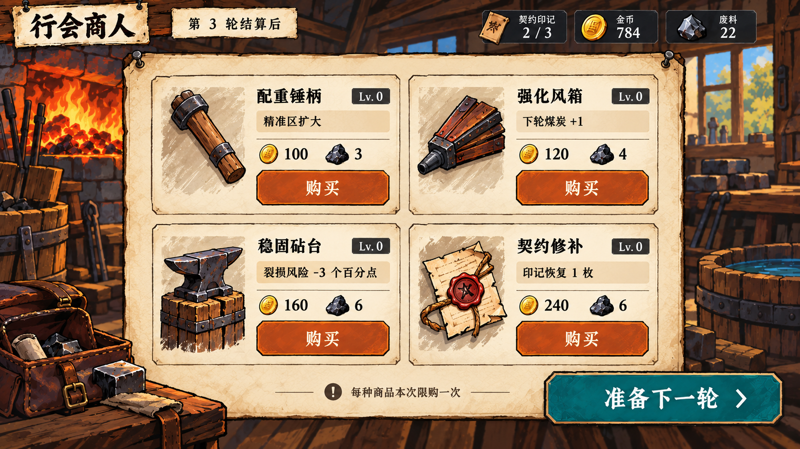
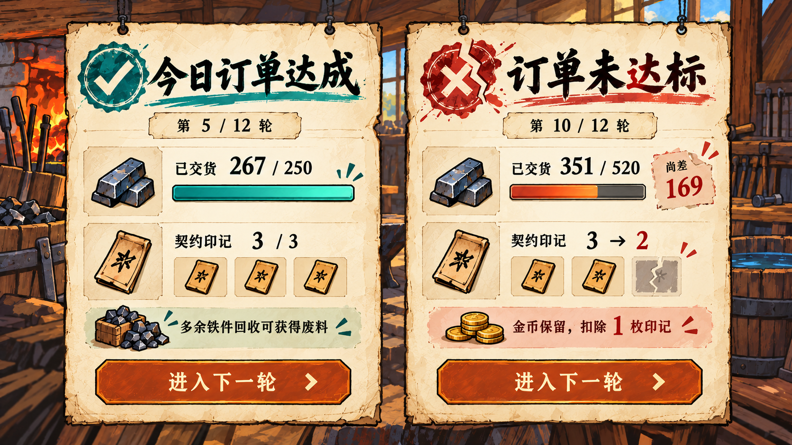
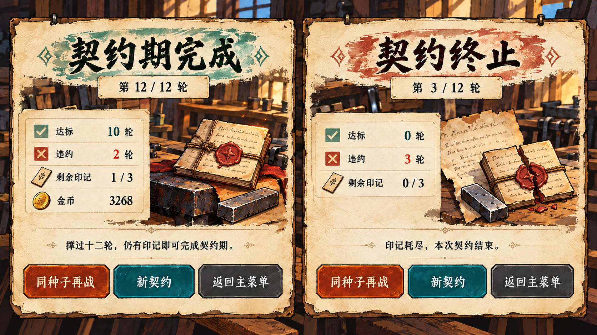

# B 行会手账 · 派生美术包

T07 / 2026-10-18。由用户已选的[B主界面v3](../concepts/main-b-v3.png)派生，保持暖木、奶油纸、深褐墨线和二维块面金属。内置image_gen生成15张原图/迭代稿；最终运行使用9张WebP，另有3张最终流程设计板。没有重新选择风格，也没有把整张HUD截图当游戏背景。

## 看稿与拼装预览

```bash
npm ci --registry=https://registry.npmjs.org/
npm run dev -- --port 4179 --strictPort
```

打开[美术拼装校验页](http://127.0.0.1:4179/design/b/preview/index.html)。可查看分层场景、三锤姿态、材料/阶级、热度、裂纹、破碎、升级装饰、九种反馈、五区计时条和商品状态。预览不执行规则、不写玩家存档，也不是正式游戏页面。

自动验证（首次先安装测试浏览器）：

```bash
npx playwright install chromium
npm run test:art
```

此命令构建后用实际dist图片与设计专用页面验证，并把报告/截图写到tmp/art-verification。已归档的[浏览器证据](../../docs/evidence/T07/browser-art.json)与[T07报告](../../docs/reviews/T07-art-validation.md)对应本轮最终版。

## 可复用运行素材

所有9张运行图合计 **2,652,400字节 / 2.53 MiB**；即使全部加载也低于3 MiB图片预算。运行只读取public/assets/b，不依赖个人生成目录、Python、imagegen服务或API key。

| 图层 | 运行文件 | 原始图 / 提示词 |
| --- | --- | --- |
| 空工坊背景 | [WebP](../../public/assets/b/workshop-background-v1.webp) | [PNG](originals/workshop-background-v1.png) / [prompt](prompts/workshop-background-v1.md) |
| 轻锤 | [WebP](../../public/assets/b/hammer-light-v1.webp) | [PNG](originals/hammer-light-v1.png) / [prompt](prompts/hammer-light-v1.md) |
| 标准锤 | [WebP](../../public/assets/b/hammer-standard-v1.webp) | [PNG](originals/hammer-standard-v1.png) / [prompt](prompts/hammer-standard-v1.md) |
| 重锤 | [WebP](../../public/assets/b/hammer-heavy-v1.webp) | [PNG](originals/hammer-heavy-v1.png) / [prompt](prompts/hammer-heavy-v1.md) |
| 砧台 | [WebP](../../public/assets/b/anvil-v1.webp) | [PNG](originals/anvil-v1.png) / [prompt](prompts/anvil-v1.md) |
| 熟铁0–7阶 | [WebP图集](../../public/assets/b/material-iron-v1.webp) | [PNG](originals/material-iron-v1.png) / [prompt](prompts/material-iron-v1.md) |
| 精钢0–7阶 | [WebP图集](../../public/assets/b/material-steel-v1.webp) | [PNG](originals/material-steel-v1.png) / [prompt](prompts/material-steel-v1.md) |
| 陨铁0–7阶 | [WebP图集](../../public/assets/b/material-meteorite-v3.webp) | [PNG](originals/material-meteorite-v3.png) / [prompt](prompts/material-meteorite-v3.md) |
| 商人器具 | [WebP](../../public/assets/b/merchant-kit-v1.webp) | [PNG](originals/merchant-kit-v1.png) / [prompt](prompts/merchant-kit-v1.md) |

[运行清单](../../public/assets/b/manifest.json)记录实际尺寸、路径、体积、hash、alpha、24个sourceRect与锚点；[完整来源清单](manifest.json)另保留原图/提示词hash、工具输出位置、引用关系和弃用版本。配置在[layout.json](layout.json)，色板/字体/间距在[tokens.css](../../public/assets/b/tokens.css)。

图集是逻辑2列×4行，实际行间距由空隙测得，**不能把高度直接四等分取图**。每帧按sourceRect读取、anchor落在可见铁件底部中心；三锤pivot为握持点、strike为接触点。背景、砧台和铁件不合并，因此可以独立做热光、裂纹、位移和旋转。

## 流程设计板



第三轮真实可达样例：784金币、22废料、2印记；四商品价格100/3、120/4、160/6、240/6，砧台降低的是3个百分点。正式页面由内核提供报价、限购和禁用原因；修补用“本次已购”状态，不作为永久升级等级。



达标267/250；违约351/520、缺169、印记3→2、金币保留。日终统计只解释已结算结果，不重新执行交货、回收或扣印记。



通关按T06中等误差正式回放：十二轮、达标10/违约2、剩1印记/3268金币。失败按第三轮原坯回放：达标0/违约3、印记0。通关不写成所有订单达标；印记始终用纸质契约标识。

最终流程prompt：[商人](prompts/merchant-screen-v1.md)、[日终](prompts/round-summary-board-v1.md)、[终局修正](prompts/ending-board-v2.md)。原稿、修正理由和版本链均保留，未覆盖原始生成图。

## 状态、色板与实施接线

| 正式规则字段 | 表现层消费方式 |
| --- | --- |
| piece.material / tier | 读取对应材料图集frames[tier]，名字与数值仍从RunView显示 |
| heat | 独立暖色/热光层；环境反光不充当热度读数，不影响风险计算 |
| integrity / status | 裂纹、最后一格警示、破碎分片与终结纸签；完整度数字同时可见 |
| upgrades.handle / anvil | 铜箍/铆钉装饰；精准区比例与裂损风险由正式视图给出 |
| upgrades.bellows / coal | 风箱商品和煤配给文字；美术不自行增加煤 |
| 时机与结果事件 | 精准八向短纹、普通接触点、偏击划痕；成功进度、裂损折线、破碎分片分别反馈 |
| deliver / recycle | 交货纸签与订单+金币；回收循环与只加废料，不能复用成第二次资源变更 |
| summary / terminal | 纸质契约印记、达标/违约与本局统计，重开/返回按钮由后续页面接线 |

原生状态稿见[铁件状态层](../../docs/evidence/T07/state-layers.png)与[反馈/计时/商品状态板](../../docs/evidence/T07/feedback-components.png)。精准不保证成功，偏击也不必然裂损；时机与结果不是同一分类。

纸色#f2e3bd，墨色#2b211b；对纸色对比度：墨色12.35、木色7.55、主操作5.16、青色5.82、危险5.73、警示6.12、辅助文字5.06。炉橙#e76a24只作热光/装饰，不承担小字。标题使用系统中文衬线、正文系统无衬线，未打包外部字体；正文16px、辅助≥12px、控件≥40px、间距4/8/12/16/24/32。

动效分准备→接触→反馈→复位，预览一次约450ms；实际规则先接受/保存再播放。暂停/后台取消演示，减弱动效用静态接触与文字。预览代码在[scene.js](preview/scene.js)，只用于美术拼装；T08将正式接输入/会话，不能把这里的固定样例、预览参数或测试入口当游戏状态。

## 美术维护

生成和修图全部使用内置image_gen，未用CLI/API fallback，具体模型标识未由工具公开。源PNG保持生成字节；cwebp 1.6.0以q90编码运行格式，alpha质量100、exact，浏览器逐像素核对透明通道一致。RGB为有损编码，本轮平均误差约2.76–3.76/255，已视检。

[prepare.py](../../scripts/art/prepare.py)仅以Pillow读像素/测矩形/比对alpha，调用cwebp导出格式，不重画或裁改PNG。维护时需要Pillow与cwebp；本轮使用Pillow12.3.0。已存在的WebP不重写，新美术使用新版本文件名。所有原图均已落盘，不必重新调用生成服务来运行或验证。

弃用稿：[陨铁v1](originals/material-meteorite-v1.png)方向不一致；[v2](originals/material-meteorite-v2.png)已修方向但帧边留白不足；最终v3扩大留白。[终局v1](boards/ending-board-v1.png)误用煤块/奖章，最终v2改为契约纸牌/文书。修正prompt均在prompts目录，来源链见manifest。

本项保留T07可复用美术与设计稿。T08已接真实工坊/教学/输入，T09已接商人/收据/终局并跑真实页面胜负，见[R3](../../docs/reviews/R3-full-contract-flow.md)；T10–T12继续声音/设置、完整品质与最终验收，不把设计预览替代游戏证据。
