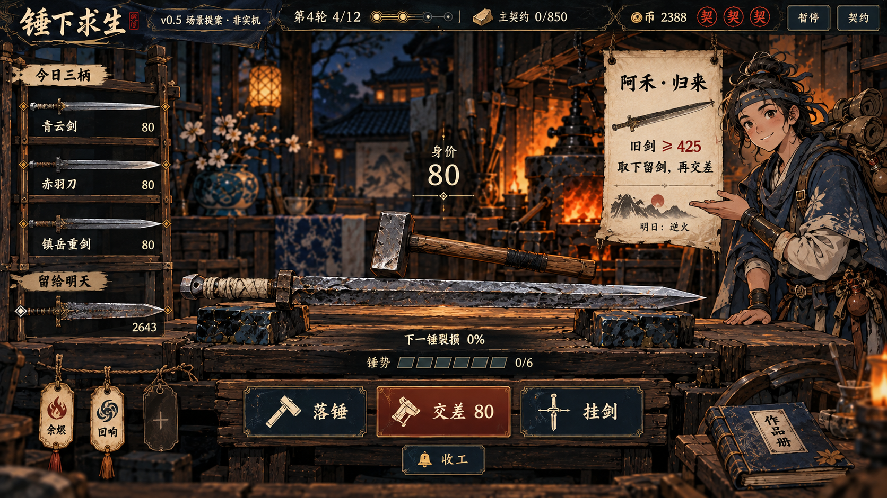

# 来客进工坊：v0.5场景提案

**这是待确认的设计稿，尚未开发，不是当前试玩截图。** 当前4179仍为v0.4行旅版。沿用用户已选D，不要求重新选主界面。

来客从纸内装饰移到炉边，挂纸只说明一项愿望和明日预告；真实剑和自然锤姿居中，三门手艺成为左下实体挂件，右下是一册可主动翻开的作品。数值/文字/按钮仍需原生实现，不把这张图贴进运行页面。

这张构图用[真实v3经济快照](../../../docs/evidence/T11-4-2-3f/visual-economy-example.json)：第4轮、0/850、2388金币、三印、三柄80新剑、2643旧剑、余烬/回响。来客示意采用待确认方案的“归来”，不是声称该seed已经运行v4。图中的轮次路标、武器阶段细节和命中区不作为运行证明；实施按实际十二轮/真实等级、DOM文字及44px目标核验。

内置imagegen生成，原图源路径/完整引用与hash在[manifest](manifest.json)，实际完整提示词在[prompt](main-customer-v1.prompt.txt)。未覆盖旧图，没有Steam美术。具体界面/只读投影/原档不变合同见[实施说明](../../../docs/v0.5-notebook-interface.md)。图上v0.5表示界面版本，经济规则仍forge-v3/schema3；下一任务直接接界面，不等待一份冗余的新规则批准。
