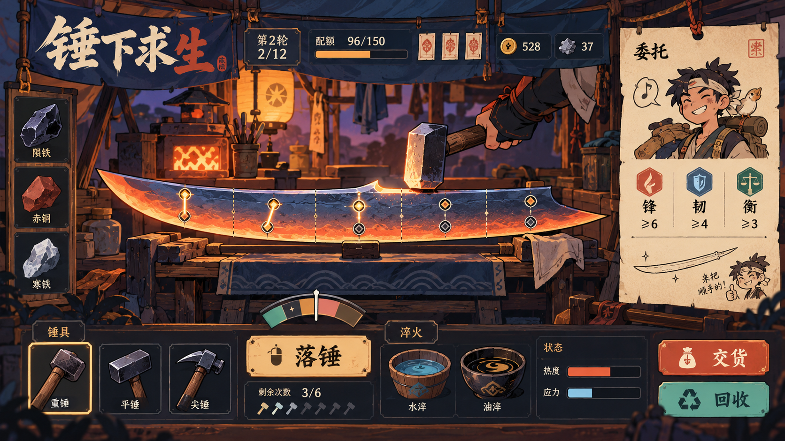

# v0.3 主界面方向

**当前方向：D「行脚灯炉」**。用户在本会话对下图明确回复“美术风格我偏向于这个版本”，附件原始路径为`exec-a334efd3-b941-4d1f-8a2d-c349d69a5ef2.png`。这是美术方向偏好；不是对尚未交回的v0.3规则的批准。[原始答复记录](../../docs/decisions/2026-10-18-v03-art-preference.json)。

保留：靛蓝布篷、橙色灯炉、粗墨线与块面手绘、木作器具、浅纸委托与有表情的顾客、大比例剑身、刀刃橙热/剑脊冷蓝。原B「行会手账」已经获得过确认，但现版资源被真人评价为缺乏新意，此D是最新方向；旧稿/旧运行资产保留。

## 从图到实现

- 剑占交互主体，固定只有一个剑柄和一个剑尖。当前图两端尖锐、柄不清楚，不能照搬这处形体错误；正式轮廓按规则绘制，锻纹不能看成不可逆裂纹。
- 五节十点、选点/连线/热度/裂纹由代码基于真实剑状态绘制；不用整图作为页面，不将生成的标记烘进背景。
- 标题、数值、订单、按钮、焦点都用可编辑DOM。当前图的额外字、重复轮次、标签/“3/6”仅为概念示意，须用[v0.3提案](../../docs/v0.3-gameplay-proposal.md)中正式读数替换。
- 实际材料先保留熟铁/精钢/陨铁三种，图中的赤铜/寒铁不代表批准了新材料。正式锤法为轻锤/平锤/重锤，不照抄图中的“尖锤”。水/油淬容器与试剑按钮需要独立命中区域；试剑不能误标成第二种淬火。
- 正式场景的有效区、风险/剩余煤/配额和操作出口在1280×720必须同时可用；剑和每个点不少于44px命中区域。画面风格先保留，但布局会按真实操作验证调整。
- 运行资产目标为独立背景、三锤、三材料的柄/刃可拼图层、三顾客肖像、商人/试剑/结算所需小道具；统一镜头/笔触/光源/色板，前景用真实alpha。剑的实际五节轮廓与纹线是代码图形，避免每一状态生成一张互不一致的剑。
- 动态表现：接触处火星/金属回弹、选点短亮、淬火蒸汽、三种试剑的切入/挡击/顺手轨迹；系统减弱动效时保留静态结果和文字。无长时不可跳动画。

## 备选与生成来源

未选B2「青釉断金」保留作探索记录：[方向图](concepts/main-b2-v1.png)、[设计brief](prompts/main-b2-v1.md)。其生成结果偏厚重/写实，标记数量与长数值也不是最终规则。D的[设计brief](prompts/main-d-v1.md)、[实际工具提示词与图稿hash](generation-records.json)可核对。

两张均由内置`image_gen.imagegen`生成，不使用CLI/API key。无参考图片输入，未复用竞品图像/角色；Steam截图仅用于研究交互主体/节奏，未作为项目运行资产。生成原件在Codex默认目录，项目副本在本目录`concepts/`。后续从D派生前先以此图作为风格参考，继续保存原图、提示词、来源/迭代链和运行转换hash。

图稿表达方向，不能声称已经接入新版游戏或已获得玩法通过；4179当前仍是v0.2快照。
