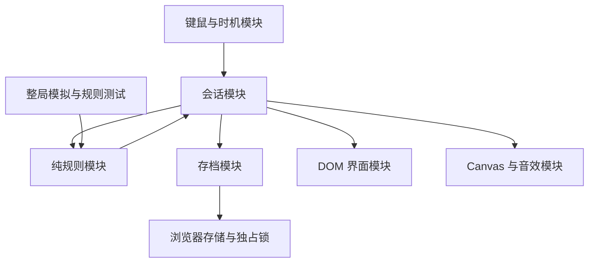

# 代码架构与玩法内核约定

> 版本范围：本文保留v1分层。v2新增core-v2与独立入口，并从既有存储/会话提取类型化规则适配口，详见[v0.3核心说明](v0.3-core-and-preview.md)。原版解释器与旧档继续保留。

版本：v0.2，2026-10-18。状态：用户已确认方案并选择B；纯规则/存档/R2/B美术、[T08工坊](reviews/T08-workshop-validation.md)、[T09经营/终局](contract-flow.md)及[T10设置/音效/恢复](settings-and-audio.md)已接线；实际结果见对应报告，T11–T12继续更广验收与最大审查。玩法依据：[游戏设计](game-design.md)；交付顺序：[实施方案](implementation-plan.md)。

本文件描述完整目标架构。规则入口为createRun/applyCommand/getRunView/validateRun，T09增加只读getRunLedger；T08已加入index.html与主装配。构建先生成网页，再用独立vite.sdk.config.ts保留core/session SDK及共享chunk，不把设计预览或测试入口打进页面。见[T04](reviews/T04-kernel-validation.md)、[T05](reviews/T05-persistence-validation.md)、[持久化合同](persistence-and-merchant.md)、[工坊合同](workshop-implementation.md)与[经营接线](contract-flow.md)。

## 1. 架构决策

选择 **TypeScript + Vite，原生 DOM/CSS 界面 + Canvas 2D 工坊场景**。这是固定空间、三件铁坯和少量动画的单人游戏，不需要通用物理引擎、服务器状态或复杂场景导航。运行时不引入第三方框架；开发工具负责类型、构建和测试。

DOM 承载文字、数字、按钮、弹窗、进度和焦点，Canvas 只绘制工坊、器具、美术层与粒子。Canvas 不拥有货币、风险、随机数或胜负。美术选择只能改变呈现，不改变规则或存档。

曾考虑全 Canvas：文本布局、键盘与可访问性成本偏高；考虑通用游戏引擎：本轮缺少刚体碰撞、多关卡等需求，增加运行时和资源管理成本。若实际性能或玩法扩展证明需要，再有据修改架构。

## 2. Module、Interface 与 seam

按 codebase-design 的用语：每个 Module 用一个小 Interface 隐藏复杂行为；seam 是调用方可以替换实现的位置。规则在一个深 Module 内保持 Locality，网页、模拟和测试通过同一 Interface 获得 Leverage。



| Module | Interface / 调用方需要知道的约定 | 内部隐藏的复杂性 |
| --- | --- | --- |
| 纯规则 | 创建一局、提交带版本的动作、读取视图、校验外部状态；全部同步、纯函数 | 来料、概率、进度、价值、资源、商人、结算、胜负与随机序列 |
| 会话 | 订阅视图、发送意图、新开/续玩、暂停/恢复、销毁 | 单次击打锁、页面阶段、当前选择、存档脏状态、反馈时序 |
| 时机输入 | 开始、释放、取消；返回整数落点 | 键鼠归一、时钟、往复游标、重复输入/失焦处理 |
| 存档 | load、save、retry、清理已确认覆盖的槽位；返回结构化结果 | JSON/版本校验、主备份、错误、同源独占写入 |
| 界面/场景 | render(只读视图)、play(本次事件)、dispose | 布局、焦点、资产、动画、音效与像素密度 |

真正变化的 seam 是：浏览器与内存存档 Adapter、真实时钟与可控时钟 Adapter、网页与无界面模拟调用同一个规则 Interface。不要为每个加减运算创建一层转发 Module；不要建设通用事件总线或插件系统。

## 3. 拟建文件布局

以下为目标布局；core、持久化/存储、模拟、美术、应用/输入/场景/教学/阶段及设置/音效已实现。design/b/preview仅作设计校验，实际路径以仓库为准。

```text
src/
  main.ts                 # 装配并启动；不写玩法公式
  core/
    index.ts              # 唯一供生产调用方使用的 Interface
    model.ts              # 状态、动作、结果类型
    rules.ts              # 常量表与公式
    random.ts             # 固定算法、双随机流
    game.ts               # 纯状态转移
    validate.ts           # 导入状态的结构/语义校验
    view.ts               # 可操作项、概率与派生值
  application/persistent-session.ts # 已实现：唯一工作副本、命令、保存与生命周期
  application/session.ts  # 已实现：路线/暂停/表现编排，委托持久化会话，教学独立
  platform/
    storage.ts            # 本地存档 Adapter
    writer-lease.ts       # 原生独占锁与释放
    browser-session.ts    # Window 生命周期接线
    input.ts              # 单一键鼠所有者/捕获/取消
    timing.ts             # 纯三角波与attempt身份
    audio.ts              # 已实现：短音效/手势/音量/限流/异步生命周期
    settings.ts           # 已实现：独立偏好、结构校验、dirty/重试与跨窗采纳
  presentation/
    app.ts                # 已实现：稳定根节点、菜单/工坊/阶段路由与弹窗
    phases.ts             # 已实现：日终/商人/终局DOM与确认意图
    assets.ts             # 美术清单/图片尺寸/矩形加载校验
    workshop.ts           # 工坊 DOM 控件
    scene.ts              # Canvas 场景与效果
    styles.css            # 布局和选定风格 token
  tutorial/lesson.ts      # 已实现：三课固定示例，准备和操作均走正式核心，不写正式档
  persistence/index.ts    # 已实现：宿主/浏览器会话入口
scripts/simulate.ts       # 调用正式内核的策略模拟
tests/core/               # 规则、恢复和不变量
tests/e2e/                # 真实网页输入与整局验证
public/assets/            # 最终运行素材
design/                   # 三套概念、选定稿、衍生稿与提示词
docs/reviews/             # R1–R4 与验证结果
```

规则 Module 禁止导入 DOM、Canvas、localStorage、AudioContext、时钟或 UI；不能调用 `Math.random()`。测试从正式 Interface 进入，避免复制一套锻造算法当“正确答案”。场景随机火星使用自身随机源，绝不能消耗规则随机流。

## 4. 状态模型与唯一真相

| 数据 | 必要字段和限制 |
| --- | --- |
| RunState | runId、原始规范化 seed、rulesVersion、revision、phase、round、coins、scrap、coal、seals、upgrades、pieces、rng、history、purchases、stats |
| phase | `workshop` / `roundSummary` / `merchant` / `victory` / `defeat` |
| round | 整数 1–12；只在开始下一轮时加 1 |
| pieces | 长度始终为 3 的元组；id 固定为“轮次:槽位”；材料、进度 0–35、热度/应力 0–100、完整度、终结状态 |
| piece status | `active` / `delivered` / `recycled` / `broken`；后三种不可逆 |
| upgrades | 锤柄、风箱、砧台等级各为整数 0–2 |
| rng | stock 与 strike 两条随机流各保存 uint32 状态及抽样计数 |
| history | 最多 12 条；每轮唯一，保存配额、实际交货、印记变化、三件处置及破碎时损失估值 |
| purchases | 来访轮次 3/6/9、商品与扣费；每商品每次来访至多一条 |
| stats | 击打/成功/裂损数、交货/回收/破碎数、最高阶级、累计收入/支出、达标/违约轮数；可与记录交叉核验 |
| journal | 每个 Accepted 命令的规范 Action；长度等于 revision，最多 2048；选择/暂停/动画不计入 |

当前选择、锤法、弹窗、暂停、游标时间、动画、音量和焦点不在规则状态中。视图选中件失效时切到第一件仍 active 的铁坯；没有可用件时清空选择并突出结算。参数通过 `pieceId` 明确指向目标，不依赖某个闭包里的旧选中件。

阶级、价值、配额缺口和可执行操作都由规则视图派生，不在多个地方分别存储。倍率使用整数十分位 `[10,16,25,38,56,80,115,160]`，价值统一计算为 `floor(baseValue × multiplierTenths / 10)`，避免浮点乘法导致边缘价格不一致。

## 5. 纯规则 Interface

| 操作 | 输入 | 输出与约束 |
| --- | --- | --- |
| createRun | 应用生成的 runId、seed；空输入由应用生成种子，非空输入由内核统一规范化/校验 | 成功返回轮 1 全新状态；非法种子返回结构化错误；不读取存档、不启动教程 |
| applyCommand | 当前只读状态 + `{runId, expectedRevision, action}` | Accepted：新状态与本次领域事件；Rejected：原状态与错误码；不抛用户输入异常 |
| getRunView | 状态、选中件 id、锤法 | 配额/价值/三种时机的风险、可执行动作与禁用原因；不修改状态或抽样 |
| getRunLedger | 合法状态生成的RunView | 深冻结的已结算轮收据/三件去向/损失估值/购买标签；复用同一规则表，不改状态或抽样 |
| validateRun | unknown 数据、期望 rulesVersion | 成功返回经过重建的规范状态；失败返回具体原因；拒绝不可信字段，不能直接类型断言后使用 |

动作集合：`strike(pieceId, hammerMode, timingMark)`、`heat(pieceId)`、`deliver(pieceId)`、`recycle(pieceId)`、`settleRound(recycleRemaining)`、`advanceSummary`、`buy(productId)`、`leaveMerchant`。新局/重开由 createRun 完成，不给旧局添加“复活”动作。

Accepted 恰好增加一次 revision。runId 不符、revision 过期、阶段错误、铁坯已终结、零热、满阶、满热加热、煤不足、余额不足、满级、限购、非整数落点等情况均 Rejected；保持状态、随机数、货币和 revision 完全不变。重复事件携带旧 revision 会被拒绝，无法重复结算。

事件为本次返回值，如 `StrikeResolved`、`TierRaised`、`PieceDelivered`、`PieceRecycled`、`PieceBroken`、`RoundSettled`、`PurchaseMade`、`RunEnded`。加载存档只渲染状态，不重播上次奖励/音效/扣印记。事件不驱动第二次经济变更。

## 6. 阶段与合法出口

| 当前阶段 | 合法推进 | 下一个阶段 |
| --- | --- | --- |
| workshop，有 active 件 | 敲击/加热/交货/回收；确认提前收工 | 仍 workshop，或结算后的阶段 |
| workshop，三件已终结 | 只允许结算 | roundSummary / victory / defeat |
| roundSummary，非商人轮 | 查看结果后继续 | 下一轮 workshop，三件新坯 |
| roundSummary，第 3/6/9 轮 | 查看结果后继续 | merchant，仍为刚结算的轮次 |
| merchant | 按规则购买；确认离开 | 购买后仍 merchant；离开后下一轮 workshop |
| victory / defeat | 只读本局总结；主菜单；新种子/同种子重开 | 新建一局或主菜单，不允许修改旧局 |

结算是一笔原子变更：若有 active 件且 `recycleRemaining=false`，拒绝；若为 true，先一次性回收它们，再读取交货总值、判配额、至多扣一枚印记、记录日终。印记归零优先失败；否则轮 12 通关；否则进入 roundSummary。失败和轮 12 绝不进入商人。

配额只从当轮 delivered 件求和。三件处理完不自动扣印记；轮次继续时重置煤为 `1+风箱等级`，不把上一轮余煤累加。商人离开/日终继续不能重复生成材料。

## 7. 随机性与可重放

- seed 字符串先 NFC 规范化、去除首尾空白，限制 1–64 个 Unicode 码点；空输入由浏览器 `crypto.getRandomValues` 生成可见十六进制种子。runId 仅区分会话，不影响玩法随机。
- 用固定的 UTF-8 FNV-1a 32 位散列，分别对 `seed + "|stock"` 和 `seed + "|strike"` 初始化两条 Mulberry32 流；固定常量、`Math.imul` 与 uint32 转换，代码实现时用已知向量与重载回放验证。
- Mulberry32 每步状态加 `0x6D2B79F5` 后取 uint32，再按固定混洗生成 0–1（含 0、不含 1）的结果；0 是合法初始状态，不替换为临时随机数。
- 第 1 轮固定材料不抽样；第 2–12 轮每轮恰好取 1 个 stock 样本，`u<0.35` 熟铁、`u<0.80` 精钢、其他陨铁。固定另两件为熟铁与精钢。
- 每个合法 strike 恰好消耗 1 个 strike 样本，包括风险为 0 的精准击打；取消、预览、加热、交货、回收、商人和非法操作均不消耗随机数。
- 两条流分离使明日来料不被今日击打次数改变。相同 seed + 相同动作序列 + 相同 rulesVersion 的规则结果必须完全相同。

这用于可复现和避免正常刷新重抽，不宣称本地单机存档防篡改。模拟器必须使用该内核与随机算法，不自建另一套近似模型。

## 8. 时机输入与动画时序

落点使用整数 `timingMark` 0–10000；中心 5000，精准半宽 `600+200×锤柄等级`，普通半宽 2000，端点用 ≤ 归入较好区域。界面与内核共用此分类，避免 0.44 等小数比较的误差。

完整周期按锤法取 1600 / 1400 / 1200 毫秒，慢速模式乘 1.5。设 `p=(有效经过时间 mod 周期)/周期`，游标为 `round((1-abs(2p-1))×10000)`；从左端起，中心每半周期经过一次。

按下记录时钟；松开用**松开事件发生时的单调时钟**重新求落点，不能用上一帧缓存值。rAF 只显示同一个函数的结果，不用帧数决定玩法。[rAF 文档](https://developer.mozilla.org/en-US/docs/Web/API/Window/requestAnimationFrame) 提醒按时间推进，以适应高刷新率及后台暂停。

时序：准备 → 松开锁定 → 规则提交并同步尝试保存 → 播放约 350–650ms 的接触/反馈 → 解锁。逻辑结果先落地，动画仅展示事件；刷新不能取消已经确认的裂损。减弱动效可缩短反馈，不改变概率。

键鼠共享唯一 attempt；鼠标准备期间的空格或重复 pointerdown 忽略。Space 仅在工坊击打区域拥有快捷键焦点时拦截，输入框/按钮/弹窗上遵循原生行为；`event.repeat` 不开始新击打。使用 pointer capture，`pointercancel`、`lostpointercapture`、blur、hidden、Esc、暂停、切换材料/锤法或改变时机速度设置均取消，旧 keyup/pointerup 不得落锤。attempt 记录开始时的目标、锤法、周期、runId/revision，不允许准备中途更换参数。鼠标正常移出仍由 capture 接收释放，只允许释放已持有的 attempt。

会话另有递增 generation；新开、恢复、返回/销毁都会使旧异步结果失效。资源加载、动画完成和音频恢复回调须检查 generation，防止上一局的晚到反馈解锁新局、重绘旧材料或启动过期声音；它不是操作身份或随机数，不能取代 runId/revision。

## 9. 存档、恢复与多窗口

存档主键 `sword-led.save.v1`、备份键 `sword-led.save.backup.v1`、设置键 `sword-led.settings.v1`。Envelope 包含 `schemaVersion=1`、`rulesVersion="forge-v1"`、savedAt（仅展示）和 RunState。正式确认/复核后冻结首个规则版本，调整不兼容规则须升级版本并明确提示，不静默混用。

读取流程：try/catch 存储 → 256 KiB UTF-8 上限 → JSON unknown → envelope/schema/rules/日期 → 有界纯 JSON/整数 → seed/runId 重建 → 通过正式内核回放 journal → 全快照一致性核对。非法命令、伪造钱/统计/随机位置、错误历史/阶段/完整度及未知字段均拒绝；不执行输入 getter，不把“JSON 能解析”当合法状态。

累计账目只统计一次：history 只含已结算轮；workshop 当前轮的交货/回收/破碎尚未进入 history，校验时额外计入；roundSummary/merchant/终局的当前轮已在 history，不再重复加当前三件。coins 等于累计交货收入减已记录购买金币，scrap 等于累计回收/破碎收入减购买废料；热度、应力等当前状态不靠钱包值推断。

写入在每个 Accepted 动作后进行，单次 `setItem(main, 完整JSON)`；写前可把当前合法主档复制到备份，备份失败不阻止尝试主档。主档成功才显示“已保存”。主档失败保留内存新状态与 dirty 标记，提供“重试保存”；重试序列化当前状态，不重新执行动作。设置单独保存，写设置失败不使游戏状态回退。

普通刷新总读最新有效主档。主档损坏/不兼容则说明原因，提供明确的备份恢复或新开；不静默删除或回退。备份恢复是用户主动的异常恢复，不是假装新一击。覆盖现存进行中存档需确认。

浏览器存储可能因策略被禁用并抛错，直接双击 `file:` 的行为不能作为正式运行方式，必须通过开发服务器或 HTTPS 静态托管。[localStorage 文档](https://developer.mozilla.org/en-US/docs/Web/API/Window/localStorage)。

同源只允许一个可写游戏窗口：存档 Adapter 在开始可写会话前申请 `sword-led.writer` 独占 Web Lock，使用 `ifAvailable`，持有至会话释放/页面离开；第二窗口显示只读提示与重试入口，不抢锁、不覆盖主档。页面从 bfcache 恢复须重新拿锁并重新读取主档，不能直接复用旧内存。`storage` 事件用于发现外部变更，不充当互斥锁，也不在本窗口写入后等待自身事件。[Web Locks](https://developer.mozilla.org/en-US/docs/Web/API/Web_Locks_API)、[storage 事件](https://developer.mozilla.org/en-US/docs/Web/API/Window/storage_event)。

T05 已落实：会话唯一持有工作副本；对外 generation 使旧输入失效，内部 activationEpoch 表示激活流程，排队通知不取消后者。激活期间 active=false。workingBase 绑定该副本，读缓存变化不授予覆写许可；写前在持有独占锁时核对自身原主档。真实 BFCache 及两个窗口 dirty 冲突链已验证。

支持目标为现代桌面 Chrome/Edge、Firefox、Safari，运行在 localhost 或 HTTPS 安全上下文；Web Lock 不可用时给出具体能力提示，允许不写盘的独立试玩，不声称该模式提供存档互斥保护。存储不可用时也可明确进入内存试玩，不覆盖别的窗口。

## 10. 表现、资源与安全

DOM 根与关键按钮稳定，局部更新文本和属性，不每帧重建页面或重绑监听；所有监听、rAF、音频节点和订阅均有 dispose。重要结果通过 `aria-live=polite` 宣读，每帧游标不宣读。Canvas 提供等价文字状态，实际操作在 DOM 可访问区域。

T10应用另提供subscribeAccepted，不在订阅时或恢复时补发历史；事件含路线/局/修订身份，声音只消费新结果。音频绑定route/runId/generation，并以本地epoch取消旧resume/试听，普通revision增加不取消刚接受的短音。最多4组/12振荡源，静音/零音量/暂停/隐藏/菜单/销毁停止断开。设置模块只写sword-led.settings.v1，不碰主档/备份。反馈按钮暂时disabled造成的原生焦点丢失由局/修订/generation/epoch守护恢复，主动Tab选择不被抢回；修饰键不当作游戏快捷键。具体合同与验证见设置/音效文档。

场景资源统一用清单加载，初次加载失败有重试和具体文件提示；界面仍能保留已读档状态。Canvas 采用实际容器尺寸，DPR 上限 2；粒子池封顶 96，隐藏/暂停停止循环。锤击位姿与粒子动画不修改规则。

音效先采用原生 Web Audio 合成，金属敲击、裂损和交易分别设计；首次用户手势中创建/恢复 AudioContext，失败降级静音并保留设置入口。暂停/隐藏停止持续声源，销毁清理音频节点。[Web Audio 最佳实践](https://developer.mozilla.org/en-US/docs/Web/API/Web_Audio_API/Best_practices)。

所有文本用 textContent 或预定义模板中的安全槽位，不把 seed/存档内容拼接为 HTML；不使用 eval，不运行上传脚本。资源本地化、无第三方追踪；项目不需要 API key、账户或后端。CSP 部署建议仅允许本源脚本/资源，开发和发布策略分开。依赖锁定与资产来源检查见实施方案。

## 11. 性能与可验证性

目标：1280×720 与 1920×1080 可完整操作；60Hz 下击打时帧耗 p95 目标低于 16.7ms；高刷新率不改变时机周期；生产 JS gzip 初始预算 150 KiB、初屏图片预算 3 MiB，超出先分析再调整，不能靠删玩法达标。报告须记录浏览器/设备/尺寸，预算不是已经通过的结果。

规则与存档用 Vitest，DOM/Canvas/键鼠/真实存储/多窗口用 Playwright Chromium，并在工具可用时跑 Firefox 与 WebKit。真实完整局至少有一局胜利和一局失败；整局模拟与 UI 全流程证据分别记录，不能用注入终局状态代替实际游玩。
