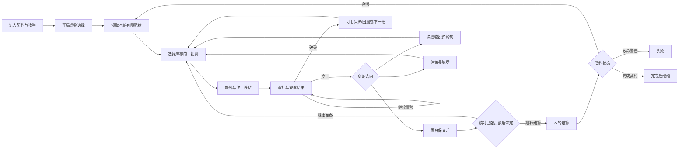

# ForgeTax：交互、流程与视觉参考复核

日期：2026-10-19（Asia/Shanghai）。本次只研究用户指定的[Steam app 5245810](https://store.steampowered.com/app/5245810/ForgeTax/)，承接[上一轮七款游戏研究](2026-10-18-forging-games.md)。目标是形成能指导实机改造的经验，解决用户指出的美术未落实与流程不清晰。

## 材料与可信度

实际读取英/中官方商店、10篇官方更新、5张原始商店截图、73.654秒官方预告片、三段官方说明动图（7.5/7.667/6秒），并观察公开实况的前5分钟。商店截图与预告用于确认空间/控件/反馈，不能证明所有按键或最新版平衡。没有购买、安装或亲自操作ForgeTax。

重新采集8个评论桶：英/简中×好/差评×热门/近期，每桶最多12条、Steam购买、保留离题/质量过滤。90行去重为73条（英文标签25、简中48）；英语差评只有9条，正文语言也不一定等于标签。是问题发现样本，不据此推算总体需求比例。原始长评/媒体仅留本机忽略目录；仓库保留查询、时间、哈希、原评回链与本文摘要，见[来源索引](evidence/2026-10-19-forgetax/index.json)。

证据分级：**O**＝媒体直接可见；**D**＝官方文字/更新说明；**P**＝玩家自述，未独立复现；**I**＝本项目设计判断。不能把P提升成已证实缺陷。搜索出现的大量非官方“手机版/破解版/模拟百万次/攻略wiki”均未作为规则来源；未使用竞品资产开发本游戏。

## 可重建的完整循环

这是多份材料拼接的流程模型，不声称看完一条最新版连续通关。贡品、遗物与商人物品使用不同资源；剑的“当前价值”和钱包金币不能混为同一个数。图中商人经营属于轮间机会，不暗示每次锻打都出现。

## 操作—反馈—去向参考表

| 环节 | 核实到的交互/可见结果 | 证据 | 对我们的启发（I） |
| --- | --- | --- | --- |
| 进入与教学 | 初次教学逐步指向场景物件；可见入神充能演示，不是一页全规则 | O：实况00:30；D：10月4/6日公告 | 一次说明当前下一步；完整公式放可展开说明 |
| 开局构筑 | 新局从三个早期遗物中免费选一个，跳教学仍选择 | D：10月6日大改 | 既有三选手艺要有造型和明确用途，延续到工坊可见状态 |
| 取剑/加热 | 官方描述先加热再放铁砧；不是直接在商店表格里加数值 | D：商店；O：工坊环境 | 我们不加搬运负担，用实体来料架和炉火回火表示同一空间 |
| 铁砧锻打 | 剑/锤在近景；价值、结果、概率、充能与当前操作同屏 | O：预告00:00/00:10、截图5 | 剑占据画面中心，操作后形状、热色、锻纹及读数一起变化 |
| 入神 | 同剑锻造10次充能，下一锤触发短暂无破碎窗口 | D：商店；O：动图1 | 学习风险积累后的释放感；本项目保留已批准的连纹/淬火，不照搬入神 |
| 结果解释 | 破坏/损伤/维持/成功/大成功分列；遗物的当前作用与总票数需要区分 | O：截图5/实况02:00；D：10月7日 | 正面只显示当前目标、热度/应力和本锤后果；完整三档预估仍可查 |
| 中止/取走 | 右键离开铁砧，E拿剑；携剑右键放下，有场景提示 | D：10月4/6/10日 | 保持键鼠可达，每阶段提供清楚出口；取消输入不触发经济动作 |
| 破碎/回溯 | E曾误消耗回溯机会，10月10日修复并加控制提示 | D：10月10日 | 危险结果后不让下一次普通输入跨阶段触发破坏操作 |
| 遗物机 | 投入实体剑换信用，再买遗物；柜台有剑数图标、余量与刷新价 | O：预告00:20–00:25、动图2、截图3 | 成本单位贴着按钮；已拥有/可替换与效果余次靠近商品 |
| 满槽 | 最新热修明确丢弃方法、保护剩余次与充能 | D：10月12日 | 既有技法三槽/替换比较要显性，不能隐藏在无说明的小字里 |
| 贡台 | 把剑放到台面，已献与所需并列，铃铛独立承担结算 | O：预告00:05/00:15；D：商店 | 区分单件交货与整轮收工；收工远离高频锻打/淬火按钮 |
| 失败后继续 | 警告累积；10月6日热修后未达标次日仍发三把基础剑 | D：10月6日较晚热修 | 不把旧评的“次日只剩两把”写成当前事实；公开惩罚且留翻盘路线 |
| 契约终点 | 契约改为21天；旧档当日保原要求，后续用新曲线 | D：10月1日API时间；社区显示9月30日 | 学习明确进度与兼容性；本项目仍为已批准十二轮 |
| 造型成长 | 商店展示差异极大的剑型；官方说明+20以后至+99无新增外观 | O：预告00:40–01:00；D：10月6日 | 成品必须一眼有变化；不把数字升级当成无穷视觉内容 |
| 图鉴/收藏 | 看见或获得会发现道具；未知轮廓/条件与跨局图鉴是另一层成长 | D：10月6日 | 既有作品簿与回信必须保留实际剑，避免交货后只剩一行钱 |
| 商人 | 与炉火、贡台相邻的幽灵/陈列物可直接看到 | O：预告00:30–00:35、截图4；P：三天节奏 | 借空间统一感；具体出场频率不单凭截图确认 |
| 战斗/结局 | 11月持剑战龙仅为开发中原型，不能作为当前已发售流程 | D：10月11日 | 本轮专注美术/视觉流程，既有试剑足以展现成品用途 |

官方规则来源：[商店](https://store.steampowered.com/app/5245810/ForgeTax/?l=english)、[官方更新汇总（按标题和日期定位）](https://steamcommunity.com/app/5245810/allnews/)。本文区分API UTC与社区显示日期，避免把时区差一天当成不同补丁。

## 媒体逐段观察与限制

官方预告共73.654秒，按5秒抽帧，另看三段说明动图和五截图：00:00/00:10铁砧、00:05/00:15贡台、00:20/00:25遗物机、00:30/00:35商人、00:40/00:45造型升级、00:50/00:55持剑、01:00/01:05贡台。动图1展示连续升级/造型和触发浮字，动图2展示投剑—信用1—购买归0，动图3是贡台与铃。预告为发售宣传素材，含旧日历/倍率，不能拿来否定后续更新。

预告通过官方HLS导入时出现三条NAL警告，退出0；后续完整抽帧解码退出0，无解码错误。保留导入/解码记录，未拿预告证明精确概率或全流程兼容。媒体仅用于观察，不复制进入运行资源。

进一步在B站站内搜索找到Atheryl的[58:31无解说全流程实况](https://www.bilibili.com/video/BV1oApw6tEQ1/)，发布时间2026-10-06 20:53:55，实际观察首5分钟，抽查00:30入神教学、01:00遗物机讲解、02:00墙面票数、04:58操作后状态。约04:59后出现登录限制，06:00/12:00/20:00尝试均停留同一299.396851秒，**这些后段没有观察成功**，不写成已看通关、不绕过登录。该视频早于最后热修，作者描述还指出误以为交差会清怒气；这只是自述/旧版本线索。Steam社区视频“周/发布至今”本次均无内容；不是断言全网没有视频。

## 玩家经验：要学的爽点与要避开的代价

下表都是摘要。概率投诉不能证明数学实现错误；好评也可能指出严重流程缺陷。

| 原评 | 实际关注点（P） | 本轮落实方式（I） |
| --- | --- | --- |
| [237631418](https://steamcommunity.com/profiles/76561198300805671/recommended/5245810/)，10月13日，好评，115分钟 | 奇特造型与入神搭配吸引人，商店选择较乏味 | 放大成品变化和实际锤；商品以用途/当前作用说明取代密集表格 |
| [237844341](https://steamcommunity.com/profiles/76561198312702205/recommended/5245810/)，10月16日，好评，146分钟 | 高级剑造型带来成就，金币过剩而剑仍是构筑瓶颈 | 同屏明确金币、配额、废料各自去向，不用数字膨胀掩盖选择 |
| [237797053](https://steamcommunity.com/profiles/76561198249974542/recommended/5245810/)，10月17日更新，好评，370分钟 | 玩家描述毁伤/继承/供剑循环，喜欢成长流最终夸张场面 | 展示真实连纹/技法触发原因；不把玩家声称的最强流当已验证最优 |
| [237025305](https://steamcommunity.com/profiles/76561198171342166/recommended/5245810/)，10月6日，好评，55分钟 | 核心聚焦，但构筑埋得深，前期重复，超规格成品缺用途 | 当前一步主提示、订单与三项性能邻近、试剑和作品簿有清楚入口 |
| [237732711](https://steamcommunity.com/profiles/76561198271161030/recommended/5245810/)，10月14日，好评，94分钟；[238052435](https://steamcommunity.com/profiles/76561199566171055/recommended/5245810/)，10月18日，差评，130分钟 | 放剑/购物时误点铃铛导致结算 | 收工放独立次操作；确认列出交货/回收去向与惩罚，不能与落锤同位置 |
| [237351672](https://steamcommunity.com/profiles/76561198133813709/recommended/5245810/)，10月10日，差评，353分钟 | 数值说明令人困惑 | 当前收益、订单差额与单锤后果分层，不并成一串长句 |
| [238037824](https://steamcommunity.com/profiles/76561199004855450/recommended/5245810/)，10月18日，好评，458分钟 | 后期一直点击疲劳 | 本轮不添加点击/搬运步骤；保持键盘、慢速、减弱动效 |
| [237052729](https://steamcommunity.com/profiles/76561198255696050/recommended/5245810/)，10月6日，差评，17分钟 | 强制锁视角难受 | 本项目固定画幅，无强制镜头摆动；打击靠局部锤/火星体现 |
| [237523920](https://steamcommunity.com/profiles/76561197991817650/recommended/5245810/)，10月12日，差评，112分钟 | 低概率破碎、回溯重复结果造成不信任 | 保留公开应力/三档预览，损坏前后明确；不据此改成隐藏保底 |
| [238015299](https://steamcommunity.com/profiles/76561198361130637/recommended/5245810/)，10月18日，好评，462分钟 | 后续只是持续倍增，缺新内容 | 不用新增轮数/更多图标回答此次美术反馈，先让现有差异可见 |

## 对本项目的诊断与实际优化顺序

实机[旧1280截图](../evidence/T12/preview-forged-1280.png)与用户本次附图已并排观察。问题不是“D名称没写对”：主场景只有195px高，四行说明占中心，三把锤小如图标，主操作是横贯表单的大按钮，整页像经营面板。用户稿则有连续工坊背景、近景大砧台、大剑横贯画面、实体工具底栏、独立纸面委托。

1. **先还原空间和比例**：场景占主要高度，剑横跨主台面；三件来料为左侧实体架，委托悬挂右侧，工具嵌入底部。同尺寸实机截图与指定稿对照，不以“接了8张图”证明完成。
2. **明确当前一步**：选材→锻打→淬火→交货的视觉路标；正在处理的阶段有文字与高亮。正常加工重点落点/锤法，淬火后重点试剑/交货，破碎给回收/换坯出口，全部处理后主提示收工。
3. **物件表达动作**：锤大且锚定实际落点；水/油为真实器具；热边/冷背、锻纹和裂纹由状态绘制。将现有素材统一到深青黑、旧金、宣纸、暖炉火，不增加无关配色。
4. **信息按决策距离分层**：顶部订单/轮次/钱包；纸单三项要求；剑旁当前属性/身价；底部本锤预估/热度/应力。进阶公式可展开，但风险、交货价和关键出口一直可查。
5. **覆盖全流程**：菜单默认引导到实际新版；练习/委托/锻打/淬火/试剑/回收/交货/收据/商人/续玩一致。新入口有可见版本标记，防止用户再次落回旧页。

实施保持forge-v2/schema2和所有数值、原档、随机/回放合同不变；只是兑现已经批准的D主界面与流程。验收以真实页面/命令/两尺寸截图和实际加载素材为准。新图稿、研究、技术通过仍不能把本次真人“未通过”改为“满意”。
