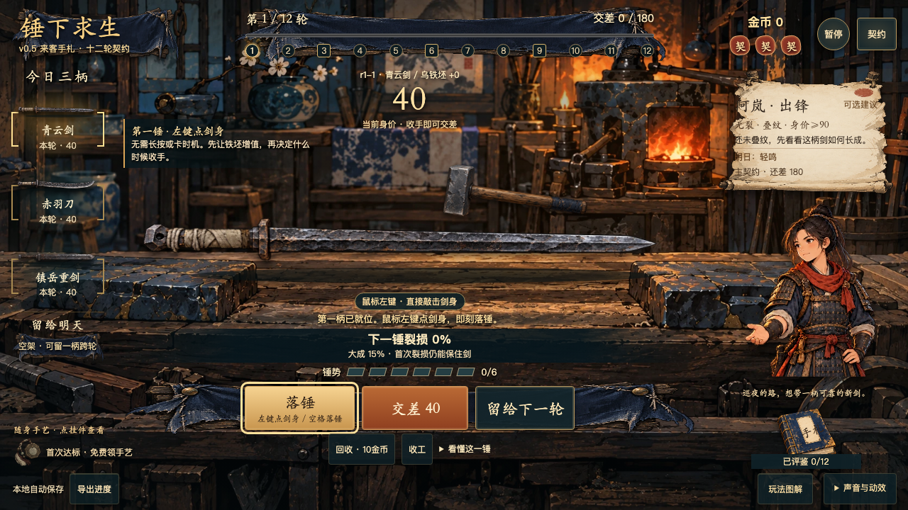

# R3.17：来客手札实际界面

2026-10-20，T11.4.2.3g。实际人物/纸单/挂件/手札已接入默认首页，本报告记录当前技术交回。原H、最终广DPR/原生生命周期/组合故障/音频/性能矩阵与最大R4仍待完成。

## 实际变化

默认首页接入三位炉边来客、等待/收剑表情、可选用途纸单和明日预告。纸单不再以静态肖像和重复参数占满右侧；三门真实手艺为左下实体挂件，完整作用主动查看。大剑和用户已经认可的自然锤姿保留。

交差仍一键结算。合意作品的真实剑影送向来客接剑区域，人物短表情/话语和纸边印签解释成果；主契约/金币即时按原规则更新，演出不挡下一步。只读手札是两页翻阅的实体册，支持键鼠，显示实际剑/等级/身价/裂纹和对应评鉴条件。主菜单、暂停、收据和完整胜负均能回顾本炉作品。

界面v0.5，规则仍forge-v3/schema3。没有新增动作、奖励、判定门槛或存档字段；不合建议的剑照常交差，印签不当契约印记。打开册页、翻页、重看作品不发命令、不抽样、不写盘。旧局直接从已有交差日志回顾真实作品，不补播盖章或伪称旧版保存过任务历史。三轮只显示三页，终局不虚构下一位来客。

## 原创资产与实机

内置imagegen生成来客六格透明图集、修正分格后最终v2，以及独立封面；原PNG/完整prompt/直接引用/hash在design/d/v05。运行两图829,100字节，小于1MiB；PNG→WebP alpha逐像素相同，RGB按q88编码。实际1254×1254和源矩形如实记录，不声称工具严格输出了prompt的1536。

v1分格线最大alpha251，可能串人物；v2两列/两行分隔alpha为0。等待与收剑腰线通过9%偏移对齐，源差只占格高约0.228%。三位人物分别有不同身份/装束，手里不画固定剑，实际成品由Canvas驱动。封面留白由原生文字标注，不烘焙数据。

[两页真实作品手札](../evidence/T11-4-2-3g/polish/book-real-work-1280.webp)与[交接](../evidence/T11-4-2-3g/release/handover-1280.webp)也来自实际页面。设计稿main-customer-v1.png仍是非实机构图参考。交回的实机图来自当前构建真实页面，不能拿概念稿充作开发成果；原截图/录像留本机，发布代表性无损图和逐项hash。

## 发现与修复

1. 初步按钮边界检查虽通过，人工看图发现保存失败/四柄未挂时，空架提示与手艺文字重叠。补真实矩形覆盖断言，Chromium红测面积4030.296875。仅在该错误状态收起空架提示；实际挂剑一出现即显示。三引擎导出/重试、四剑三手艺和实际挂剑可见通过，未放宽44px或覆盖阈值。
2. 实机交接图指出免费手艺已在左下，coach却仍指“纸单下方”。修为左下方，并以实际按钮位置与文案断言复验。合意交接终点下移至人物接剑手势区域，原锤子几何不变。
3. 默认页副标题换行、人物过小，缩短版本文字并利用真实透明留白放大人物；手札从长卡片列表收敛为两页翻阅，避免再做一张软件工作台。册页/按钮数据仍来自只读投影。
4. 定向策略工具先前把不参与模型的整套UI当作旧输入依赖，UI更新后会误拒。改为严格绑定实际core/策略/锁文件和六SDK，仍在每次运行前后冻结全部当前输入；新增纯元数据拒绝测试及9行真实输出重叠，不改旧26k/1152结果。

## 验证范围和身份

主改版同构建102/102通过（三引擎各34），零失败、跳过、重试，独立后台job88889于02:31:58Z终态0；耗时1274.002秒，251输入/48产物前后完全相同。114主改版正式UI状态对象完整SDK回放；三引擎各有一局正常188键盘命令十二轮胜利。另4份全新预览状态逐步与SDK相等。结果以[summary](../evidence/T11-4-2-3g/release/summary.json)、[terminal](../evidence/T11-4-2-3g/release/terminal.json)及[verification](../evidence/T11-4-2-3g/verification.json)为准；源/构建开始指纹、配置/runner、实际退出码、JSON用例报告、原控制台无损归档和正式SDK回放分别留证。不能把列表、启动、PID文件或仅有提交当通过。

中断前22916日志证实69项，JSON却是更早--list的0执行/102跳过枚举。句柄丢失后确认实际runner已停止，只剩本任务孤立预览服务，保留全量资料而非冒充完整102。首次独立校验因defineConfig合并产生重复webServer，在执行任何产品测试前退出1；改为单对象配置、独立报告路径与后台终态记录。上述基础设施记录不计产品通过数。

当前代码维持35个规则/会话/输入/存储/共享DOM源不变，六SDK和旧43个构建文件与3f一致；只有默认页HTML/JS/CSS变更及两张新增图片。旧B/D入口和原档保持，当前SDK对实际UI存档对象逐一完整回放，数量不冒充不同游戏局数。三引擎各自真实188条键盘命令到十二轮/三商人/三升级、独立失败/修补/旧三轮；新册页/无门槛交差/错误回退/取消/静音/减弱动效与原锤接触/成长/六道具同构建回归。

最后逐张复核又发现720高有真实作品的册页底栏默认裁切，原自动点击会滚动而漏检。新增无需滚动的nav/body/actions边界断言，红测581.625>553.75；首次局部排版候选仍15过3失败，完整保留。实际测量dialog-body固定55vh=396px而册页需要约411px，改为仅手札弹窗按88vh扣除160px标题/操作空间，撤回多余人物重排。随后新冻结构建的全部21册页用例（三引擎各7）复验，覆盖空白/真实作品、两尺寸及可达完整十二轮journal的全部六个展开页。最后21项1184终态0，133.856秒，249输入/48产物前后一致；18实际状态对象另完整SDK回放。完整102属于修补前构建；最后只有notebook.css和对应测试变化，默认HTML/CSS链接更新，45个原路径产物相同，主JS仅随构建依赖改名、内容字节仍完全相同，六SDK/图片/旧版入口均保持；不伪称最后构建一次102。新回归身份以[polish摘要](../evidence/T11-4-2-3g/polish/summary.json)为准。

247单测、Node工具5项、双配置strict/网页和SDK构建及9行当前SDK重叠各自记录。模拟只证明当前既有经济和有限性，不能替本界面的真实交互或真人反馈。Chromium/Firefox默认DPR1与WebKit默认DPR2并非全部六DPR矩阵或原生Safari/Edge认证；该责任留原最终验收。

## 交付与边界

原4179在本轮已停止/拒绝连接，没有再次杀旧服务。主改版快照tmp/previews/T11-4-2-3g曾由独立后台90863提供；手札修补另建T11-4-2-3g-polish快照由96174提供，有意接替已核实的本任务服务，在原地址提供，48个HTTP文件均同最终构建。独立新鲜浏览器默认十二轮、3次左键/3次抽样、真实交差279、翻书无命令、刷新字节保持且不补播/人物复位通过，page/console/HTTP错误为0；四份实际状态另留证。新快照同样完成3次左键/交差/初始翻页栏完整可见/刷新不补播与0错误的独立冒烟；音频/故障回退覆盖来自正式102及最后21，预览录屏无音轨，不称真人听感验证。旧快照、用户进度和原标签保留，不强制刷新。不称公网部署。

完整源码、所有运行图/原始美术/prompt、JSON报告与回放、代表截图发布到原私有GitHub；大型诊断媒体留本机并有hash，不重复推送巨型trace。README和实施说明按已实际界面重写，不留下“概念已实装”的混淆。

[杠精审查]通过（本技术子项）。逐项反查概念图冒充实装、隐性新规则/重复奖励、手札改档、旧档重播、布局遮挡、错误恢复出口、旧锤姿回退、素材串帧和虚报测试终态；已发现项有红绿与最终同构建回归。当前交回范围无已知剩余阻断，不能从绿测推断真人满意。本项为R3.16后的第一个执行项，整体H、最终广矩阵与最大R4保留；提交/远程证据由任务回执记录。

发布清单补正：第一次暂存后重跑清单只枚举未暂存文件，导致4项清单，已在推送前发现并修复为固定前置2c60eae的全部差异（含已提交/暂存/未暂存）加未跟踪文件；完整清单/Markdown/凭证扫描重新通过，不用局部清单代表全部发布。生产源、构建和测试未变。
