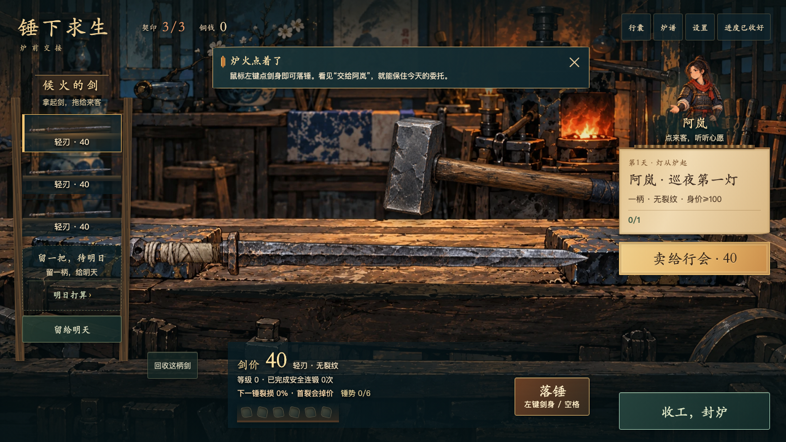
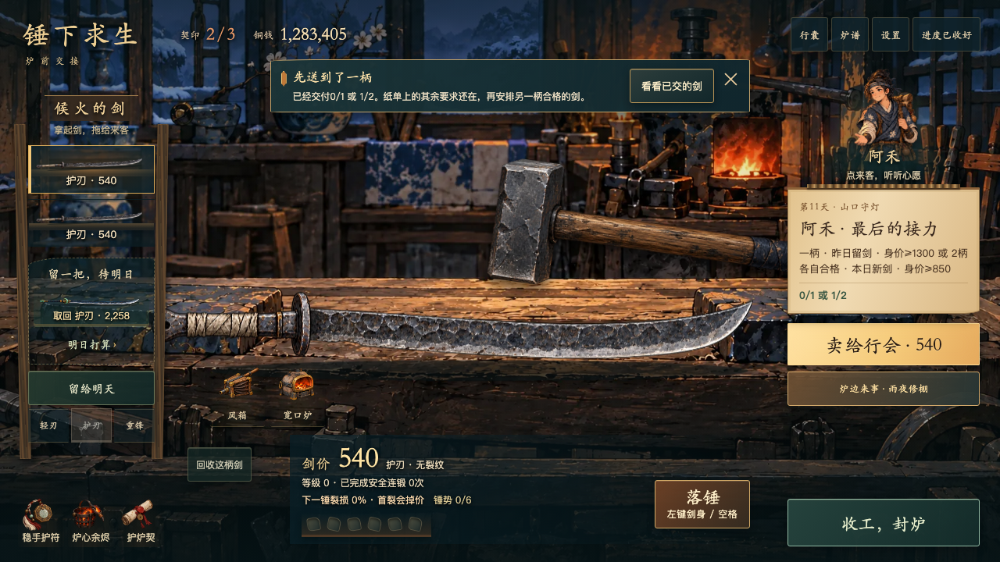

# R3.21 炉前交接

2026-10-21，T11.4.2.3j。按用户最新要求，优先交互、界面和已有玩法的实际选择；兼容／性能矩阵暂缓。使用用户指定的Game Studio，并沿Game UI Frontend、Web Game Foundations保留当前Canvas／DOM与D美术，不迁移引擎。

## 实际变化

- 来客与纸单在右侧同区，左侧是候火剑与留剑架；中央保留真实兵器、自然锻锤和左键即时落锤。六格火星蓄满时轻亮，减弱动效时静止。
- 剑卡可以实际拖给来客或留剑架。拖动只预览，松手才走正式命令；不合委托不暗卖，换架有明确确认。键盘与原按钮仍可用。
- 委托完成后在炉前收件，不强制整页跳转；部分交付用消息条，完整保留剩余纸单。挂起当前剑后自动显示下一柄，取回时显示取回的剑。章节、日终、用途回顾和三结局保持。
- 缺项／风险／安全连锻、明日旧新路线、真实留剑预览、手艺用途与献剑代价、备料真实报价均来自公开view。数值、随机、journal、schema和旧档解释器未改。
- 设置中补声音不可用说明与已有画稿的重试入口；这两项不是本轮主要玩法成果。

## Review／修复

三位代理分别只读核对C端布局、交接身份与经济唯一性、公开决策投影，root结合实际截图复核。发现并处理：

1. 消息先挡来客头像，移到侧面后又会挡移动锤头；最终使用铁砧上方单一消息区，显示消息时暂替换打造短句。1280／1920实际图均复看。
2. 落锤快捷键挤成两行，收工长字折行；拆主字和小提示，缩短启程动作文字。
3. 拖剑时库存原生Enter／Space点击可增加epoch，使拖交静默失效；拖动中禁止库存选择。真实拖动中按两键后仍只交付一次。
4. 部分收件卡盖住第二柄要求；改成上缘消息条。复用已验证历史journal前缀，实际交付一柄后看到第11天0/1或1/2与完整纸单。
5. 当前剑挂架后仍占中央；自动换下一柄，取回则显示该留剑。
6. 不合明日条件的候选曾笼统暗示可再锻补齐，改明示配方／裂纹／新旧未必可补。三槽换手艺的最终确认补回献剑身价；免费首赠也明确费用。

未发现交接取消／陈旧票据造成额外经济动作。规则与存储源码、测试文件及旧资产均无差异；运行SDK八文件与上一快照相同。83个保护文件、原输入与批准全文、21旧编译和0316备份ref均实际核验。

## 必要试玩边界

严格类型检查与双构建实际exit0（最后63090），75运行文件。单一隔离Chromium中完成第一章63个实际界面命令，额外3次挂／换／取回，验证商人、事件、首赠、改造及正式SDK逐步一致；另有历史合法第11天前缀恢复后的一次真实交付，不算新局十二天。

完整章试玩49331真实exit0后，最终仅修改消息条CSS与renderNotice的显示属性；最终构建再以68319完成8个开炉／左键／拖交／换架命令、一次历史第11天真实交付及两PC尺寸画面核对，真实exit0。原短批result沿用“one chapter”scope字符串属于工具标签错误；实际chapterActions=5、extraReserveActions=3，归档明确更正，不据此多算一章。早先画面与通过批全部留在本机，未覆盖。

原4179已切换到不可变新快照，发布后另外核对全部75HTTP字节及实际左键／拖交。详细实际对象、工具和构建输出见[证据](../evidence/T11-4-2-3j/run.json)及[published](../evidence/T11-4-2-3j/published.json)。

## 三项复核与保留事项

本次R3.21覆盖3i.5终章／炉谱、3i.6模型／引导和3j产品交互的连接：原十二天、三结局、实际作品与旧新接力没有被简化掉；模型暴露的金币富余与可选成长／留剑激励偏弱仍存在，本次没有用投影文案冒充数值修复。真人吸引力尚需新反馈，未标H通过；最终广矩阵与最大R4仍待办。

[杠精审查]通过本task：交付真实主页面、手势与流程，不以测试数量代替游戏；已知遮挡、误导和操作卡点有具体修复与必要复验。新数值／新规则的后续设计需保留规则身份与兼容边界。回滚用新增revert或旧不可变预览，不删除旧档、美术或失败原件。
