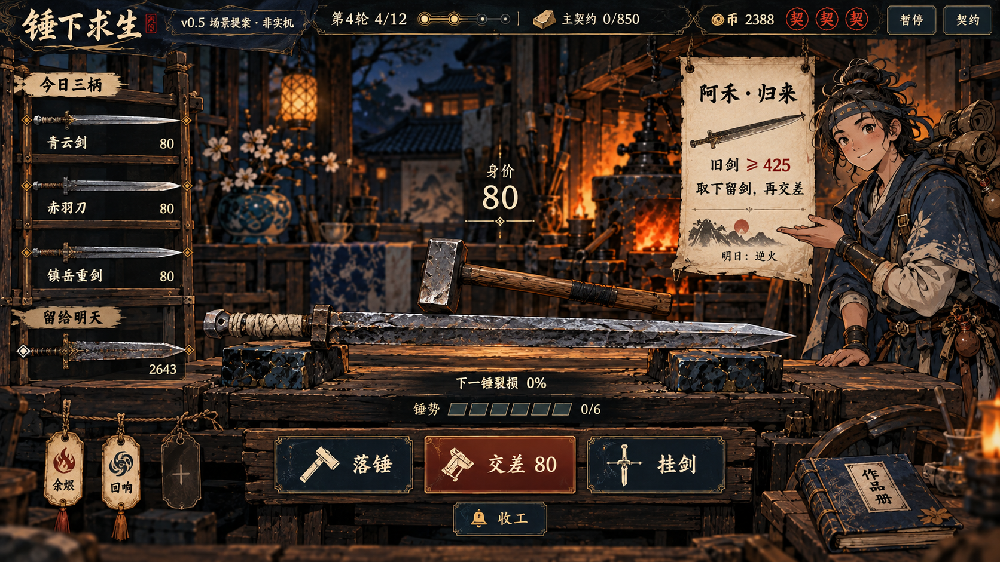

# v0.5界面：来客手札与真实作品

2026-10-20。沿用户已授权的“界面游戏化、提示/动效和整体完整性”，以及已批准D美术与v0.4实施。**界面标为v0.5，规则仍forge-v3/schema3；无新动作、奖励、判定门槛或存档字段，无需重新批准旧规则。**本轮已完成补证和纯展示投影，下一任务接实际人物/纸单/册页；当前4179仍为行旅版，下面设计图不是已开发截图。

[完整提示词/引用/hash](../design/d/v05/README.md)与[定向补证/R3.16](reviews/R3-16-purpose-and-directed-review.md)说明依据。沿[已有ForgeTax研究](research/2026-10-19-forgetax-session-study.md)的直接回报、有限剑用途和构筑因果；研究有观察日期/字幕局限，不是本人购买试玩。没有复制Steam素材。

## 玩家会看到什么

每轮一位具名来客，给出一种可忽略的打造建议。玩家可以先保住主契约，也可以为这位来客留剑、带裂继续或挑手艺。实际交出的合意作品进入本炉只读手札，留下真实剑、裂纹与一句用途说明。结局能回顾这一炉到底做成了什么。

仍然直接左键落锤，原交差自动结算。没有接受订单、额外交单、选点/卡时机或淬火步骤；册页可主动打开，不成为必经流程。没满足来客也能正常交差，**收金币、主契约、惩罚及胜负完全按原规则**。手札印签只是作品评鉴，不发金币、印记、配额、材料、手艺或跨局能力。

## 画面与交互

顶部保留主契约/印记/钱包，左侧仍三柄和保险剑，中间仍大剑与已经校正的自然锤姿。右侧让半身来客站进炉边，挂纸只容纳一条愿望、当前差项和明日预告，替代静态肖像加重复配额解释。三个≤原槽数的手艺挂件放在底栏左侧，保持≥44px目标，作用主动展开；原敲/交/留操作保留原键鼠与命中范围，视觉由木牌承托。人物不能挡交差、保存恢复和手艺。

来客固定三人：巡卫阿岚（出锋/逆火）、信使阿禾（轻鸣/归来）、老匠杜伯（炉心/留名/复炉/终章）。有稳定装束、等待/收剑短表情和交接对象，不只是纸内头像。现有D武器/道具/炉火继续用，三种兵器五阶段由真实等级和裂纹决定，不能拿统一金剑替换作品。

一轮顺序：新铁就位→看一条来客建议→照常敲/交/留→若交出的剑合意，纸边印签与人物短话解释用途→继续打造或收工。达标后可看明日一句预告，为旧剑准备去向。满足来客不追加一个结算步骤；忽略它没有额外惩罚。

同一次Accepted交差若既达主契约又成为合意作品，主契约结果仍立即入账，来客只做局部交接/印签/短话；不堆两块长弹窗。暂停、菜单、隐藏、换局、销毁清理旧表现，减弱动效为静态印签/文字，静音沿旧设置。读档重画手札，不能补播盖章或假发奖励。

## 手札的评鉴标准

这些是对已有成品的展示分类，不进入经济引擎。记Q为对应轮原配额；N为该剑出生轮普通底价，取该轮第二柄的真实base（第一柄可能含继承）。所有阈值向上取整；轻鸣使用整数36/10系数，避免浮点端点歧义。

| 标签 | 对实际已交差剑的条件 | 主要用途 |
| --- | --- | --- |
| 出锋 | 无裂、等级≥3、身价≥ceil(Q/2) | 第一轮学会收手和交差 |
| 轻鸣 | 无裂、普通锤≤3、等级≥3、身价≥ceil(36N/10) | 大成、回响、继承或提前备好的旧剑有不同办法 |
| 炉心 | 已接受≥1次连锻命令、身价≥ceil(Q/2) | 体验爆发后收手 |
| 归来 | 出生轮<交差轮、身价≥ceil(Q/2) | 提前备剑与当下交差/换手艺竞争 |
| 逆火 | 带裂、身价≥ceil(Q/2) | 稳手、裂锋、满势安全锤有具体用途 |
| 留名 | 身价≥2Q | 保底后继续冲高或留后手 |
| 复炉 | 已接受≥2次连锻命令、身价≥ceil(Q/2) | 原风险不重置，给第二次爆发准备预算 |
| 灯炉终章 | 无裂、等级≥9、身价≥2Q | 收官作品，可先完成主契约而不追求它 |

前三轮为出锋/轻鸣/炉心，第十二轮为终章。中间编排由`hashUtf8(normalizedSeed + '|notebook-v1') % 4`决定，不使用或推进任何随机流：

| 编排 | 第4→11轮 |
| --- | --- |
| 0 | 归来、逆火、留名、轻鸣、归来、逆火、复炉、留名 |
| 1 | 逆火、归来、轻鸣、留名、逆火、复炉、归来、留名 |
| 2 | 留名、轻鸣、归来、逆火、复炉、留名、归来、逆火 |
| 3 | 轻鸣、留名、逆火、归来、留名、复炉、逆火、归来 |

只展示今日与下一轮预告，远期册页标“待来客”。三轮练手只有三页，第3轮或任何终局不承诺下一位客人。当前手札标准固定为notebook-v1；以后若变评鉴内容需明确展示标准，不更改原契约或重解释经济日志。

提示是具体的：轻鸣超过三锤时说“这柄已超过三锤，可先交契约或换一柄”；三锤用完但身价不足，不能诱导继续锤去达成一个已不可能满足的建议。归来先指出是否旧剑，满足出生条件才说差价。已挂起且合意的剑明确“取下留剑后可交差”。所有数值看当前选剑，不用当前升级底价偷换旧剑底价。

## 全部事实都已存在

复核撤回了原先拟建的forge-v4/schema4方案：它会重复保存可推导的信息，增加不必要的版本/恢复成本。当前实现为[src/presentation-v3/notebook.ts](../src/presentation-v3/notebook.ts)，只依赖已有有效RunState：

- **连锻命令数**为floor((hits-charge)/6)。存活普通锤同时加hits/charge，差值不变；一次连锻清六格使差值+6，不论两/三结果或触顶提前结束都只计一次；断剑最后一锤只加hits1，floor仍不多计，断后也不能再锤。
- **N**从出生轮第二柄base读取。所有旧剑仍在blades内，处置不改base，后来升级也不改旧件；继承只加第一柄。因此不用另存一个N。
- **作品顺序**从原journal的deliver顺序恢复。已交差剑不可再改，finalizedRound保留真实交差轮；每轮只取首柄合意剑。重复命令未被接受就不入journal，换手艺/回收/断剑也不算作品。
- `getNotebook`提供当前/明日、最多12页、首件作品与只读题签；`assessBlade`提供具体条件/差项；`requestFor`提供稳定建议。缓存只针对已冻结状态，不冻结调用方对象；返回作品是自有的冻结副本，不允许读者改到经济状态。

经济对象、Action、DomainEvent、随机流、codec、key、writer lease和三个旧入口全部不变。已有档可直接回顾实际交差的剑，手札注明“按当前来客手札整理本炉作品，无额外奖励”，不声称旧版本曾保存过一份不存在的任务或来客历史。

## 作品册与结局

炉边的实体册入口≥44px。合意页展示真实pieceId/家族/等级/身价/裂纹/对应用途，未成页说明该轮建议；打开/关闭、重看短话不发命令。三、六、九、十二件分别换题签：0–2初炉，3–5行脚，6–8匠作，9–11灯炉，12灯炉留名；不发资源。

终局并列说明原主契约完成/失败与本炉作品x/12，不能拿手札印签冒充保住印记。三轮只显示练手x/3，提前失败的远期页不虚构作品。作品由本局原存档/导出可还原，本阶段不承诺跨新局永久图鉴或元进阶。

## 可复核算例

- Q180：三次普通成功40→58→84→121、等级3无裂。原交差+121金币/主契约121，再由视图识别出锋；第二柄再合意也不覆盖首件，经济照旧。
- N160轻鸣阈值576。三次普通成功232→336→487不够；回响将最后结果变成608；有一次大成的一条序列352→510→739也够。
- 真实补证seed0037：第6轮峰值811碎剑留162加值，第7轮普通底价160、第一柄实际322。若随后三次普通成功为466→675→978，满足N160的轻鸣；后三次是条件算例，不声称为该seed实际后续。
- 跨升级轮的旧剑仍用旧N。定向测试经真实命令让第3轮N40、身价144–287的剑跨到已升级的第4轮；新坯参考阈值288，旧剑实际阈值144。册页保存的展示条件必须用旧144，不能显示为288。
- 第4轮Q850，旧剑≥425合意；取回后照常交差。一次余烬连锻三次安全结果仍只计一次，不能假装已完成复炉。

## 后续直接实施的范围

本项3f先完成只读投影/补证/设计与全面R3.16；下一项3g直接兑现已授权界面：

1. 新D半身来客/表情、章纹/册页少量原图；内置imagegen、原PNG/实际prompt/引用/hash/alpha保存，新增运行资产≤1MiB，延迟加载册页框，加载失败仍有原生文字/已有肖像/真实剑回退。
2. 现有纸单、人物交接/预告、实体手艺挂件、作品册/收据/结局接投影；不复制整个主装配或引入新session。输入/异步/表现继续用原runId/revision/generation/epoch，新的表现只从Accepted前后投影差分产生，读档不补播。
3. 真实两尺寸/四剑/三手艺/错误栏与≥44px、鼠标键盘整局/失败/三轮、刷新/恢复/只读与旧入口、减弱动效/静音/取消/有界资源；同构建SDK回放与资产/HTTP身份。新UI不能被概念图代替。
4. 原最终广DPR/原生生命周期/组合故障/声音/长档性能及最大R4仍完成。经济原1000种子数据只在core/SDK等价证据成立时复用，展示评鉴另做定向/全局验证，不能据此声称真人乐趣通过。

真人验收看能否说清今天给谁做哪种剑、是否至少两次为用途改变打造/留剑/手艺选择、第三轮后是否仍想看作品，以及画面是否更像有人来往的工坊。不会把降低胜率、收藏数或绿测试当作“高可玩性”。

回滚只revert展示/素材与投影引用，原档不需要转换。任何未来改变经济/输入/存档合同的新机制仍按原要求具体确认；本次只读提示/作品呈现属于用户已经要求推进的界面工作，不为它增设玩法批准门槛。
