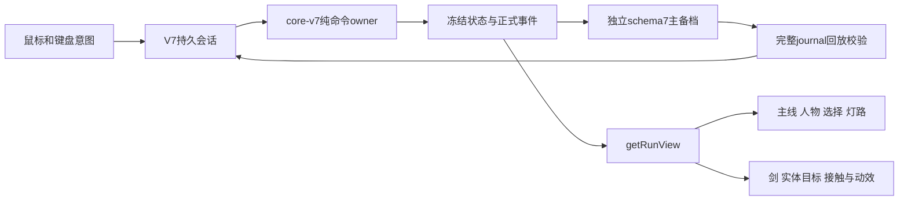

# 护炉远行的运行架构

现版使用TypeScript/Vite、DOM/CSS与Canvas 2D。沿用已确认的网页栈；规则、保存与画面各有单一事实来源。

| 模块 | 唯一责任 |
| --- | --- |
| `src/core-v7/model.ts`、`initial.ts`、`actions.ts` | 完整类型、章初资源、严格动作语法 |
| `game.ts` | 精确权限路由，先检查再复制；接受加revision/journal，拒绝保原state |
| `forge.ts`、`inventory.ts` | 普通/两技法、有限次数、双槽与真实兵器归属 |
| `encounters.ts`、`combat.ts`、`mechanisms.ts` | 作者场次、公开压力、两行动/磨损/工具、机关与实际嵌剑 |
| `campaign.ts`、`shop.ts`、`journey.ts` | 九节点/选择/奖励、交易、唯一灯芯、重整和三结局 |
| `view.ts` | 当前约定、精确动作许可/原因、伤害/压力预览与真实后日谈 |
| `validation.ts` | 从seed及接受journal回放，逐字段核对checkpoint与失败历史 |
| `src/application/v7-persistence.ts` | 独立主备键/锁、generation、脏档、恢复与确认新开 |
| `src/presentation-v7/app.ts`、`scene.ts` | DOM选择与焦点，Canvas物件、人物、接触/断裂/交接，不算规则 |

随机流只由合法普通锤推进；前三锤仍抽票但裂纹概率为0，确定技法不抽。renderer没有第二套损伤、计价、援手或结局算法。

章初checkpoint只含可回滚玩法字段；runId、revision、journal、weaponSerial、已用重整次数和失败记录不回退。每章补给在建立checkpoint前执行一次，重整后不再补发。献出、弃置或磨断的剑离开真实槽位。

界面立即把接受结果交会话保存，短暂保留旧场面仅用于接触。暂停、隐藏、尺寸变化或打开信息取消表现，不能取消已接受事实、补发奖励或产生第二次命令。返回前台重建可操作状态；进入对话先清理busy，再构建控件。

`forge-v7`、schema7、`sword-led.save.v7`／`sword-led.save.backup.v7`及`sword-led.writer.v7`独立。完整状态最多200KiB、500条接受动作；导入checkpoint没有额外信任。旧v5/v6解释器、SDK和存档保持原身份，旧入口明确可访问。

美术原件、提示词、原尺寸/alpha/SHA和运行转换在[当前美术清单](../design/d/v1-campaign/README.md)。三章背景、独立角色和目标按图层合成，母轮底座固定，运行光弧/停轮/灯芯与复明分别由事件投影。

实际核心与网页边界见[第二轮核心复核](reviews/2026-10-23-v1-core-review-2.md)、[第三轮界面复核](reviews/2026-10-24-v1-ui-review-3.md)和[完整网页路线](reviews/2026-10-24-v1-complete-browser-routes.md)。
